# Deepfake video detection with motion-compensated optical flow: design and experiment log

This document records the whole project: how the first version worked, what was wrong with it, every
design decision of the current version and the reason behind it, every hyperparameter, every
experiment with its scores, how each part was tested, the problems met along the way, the order in
which everything was done, and what each part of the code does. Negative results are kept on
purpose. It is updated as new experiments finish.

Hardware for every run: a laptop with an Intel Core 5 210H processor, 16 GB of DDR5 memory and an
NVIDIA GeForce RTX 4050 Laptop GPU (6 GB of video memory), running Windows, Python 3.14 and PyTorch
with CUDA 12.6.

Each technical section ends with a short "In simple words" paragraph that explains the idea without
any technical vocabulary.

**Abstract.** This project studies whether the motion of a face, measured by optical flow, helps to
detect deepfake videos, and in particular whether removing the rigid motion of the head before the
analysis improves generalisation to unseen datasets. The pipeline tracks the main face of each video,
computes RAFT optical flow between consecutive frames, removes the head's motion (none, mean
translation or affine fit), and combines flow and appearance in a two-stream ResNet18 network followed
by an LSTM. The protocol keeps identities strictly apart between training and test. Trained on DFD, the
model reaches a video AUC of 0.972 ± 0.017 in 7-fold cross-validation and 0.781 ± 0.032 on unseen
Celeb-DF. Trained on FaceForensics++, six versions were compared: removing only the mean translation
generalises best (AUC 0.870 on DFD and 0.739 on Celeb-DF, against 0.820 and 0.719 for the affine
removal), and flow alone fits FaceForensics++ almost perfectly but generalises worst. These results are
below the best published methods and rest on one seed per version; the limitations are detailed in §18.

Contents
1. Overview of the current method
2. The first version, and what was wrong with it
3. Preprocessing: decisions and reasons (3.1 face tracking, 3.2 clips, 3.3 wrong crops and several people, 3.4 why these numbers)
4. RAFT optical flow: what changed and why
5. Removing the head's motion from the flow
6. The network: ResNet18 and LSTM changes and why
7. Training: hyperparameters and reasons
8. Evaluation protocol
9. Datasets
10. Results
11. Problems met while running, and solutions
12. Project timeline: from the first version to now
13. How each part was tested
14. Code walkthrough
15. Next steps
16. How to reproduce
17. Related work and positioning
18. Limitations and threats to validity
19. References

---

## 1. Overview of the current method

1. **Face scan and tracking.** Faces are detected on about 8 frames per second. The detections that
   belong to the same person are linked together (a "track" per person, see §3.1), and the main
   subject of the video is chosen.
2. **Clips.** Up to 6 short pieces of 21 *consecutive* frames are cut where the main subject is clearly
   visible and alone (§3.2).
3. **Face crop.** On every frame of a clip, a square crop follows the face (256 × 256 pixels).
4. **Optical flow.** RAFT computes the motion between each frame and the next: 20 flow maps per clip.
5. **Head-motion removal.** At training time, the head's overall (rigid) movement is subtracted from
   each flow map, which leaves the motion *inside* the face (§5).
6. **Two-stream network.** At each of the 20 steps, one ResNet18 reads the flow map and another reads
   the face image. Their features are joined and passed through a 2-layer LSTM, which outputs real or
   fake for the clip.
7. **Video decision.** The score of a video is the mean of its clips' scores, compared with a threshold
   chosen on validation videos.

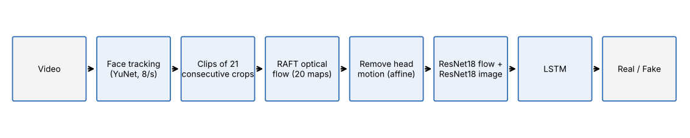

**In simple words.** The detector watches short pieces of a video, cut tightly around the face, and
looks at how every point of the face moves from one picture to the next. A real face moves as one
piece. A fake face is like a mask pasted onto a real head: when the head moves, the mask sometimes
slides, stretches or flickers a tiny bit. The detector is shown thousands of real and fake examples
and learns to notice these small slips. It also looks at the face pictures themselves, because a mask
can have visible edges or colours that do not match.

The code is in the `deepfake_flow` package: `faces.py` and `preprocess.py` (steps 1–3), `flow.py`
(step 4 and the flow transforms of step 5), `model.py` (step 6), `data.py` and `metrics.py` (splits,
dataset, metrics), `train.py` and `evaluate.py` (training and testing), `predict.py` and `app.py`
(step 7 on a new video), `experiments.py` (every experiment in order). See the README for the layout.

---

## 2. The first version, and what was wrong with it

### 2.1 How it worked

| Stage | First version |
|---|---|
| Frames | `ffmpeg` extracted the **whole frame** at **5 frames per second** and saved PNG files |
| Resize | every frame was squashed to 256 × 256 (aspect ratio not kept) |
| Optical flow | RAFT (Sintel weights, 32 iterations) on consecutive extracted frames; input made with `ToTensor()`, i.e. values in **0..1** |
| Flow normalisation | each flow map standardised on its own: `(flow − mean) / std` |
| Samples | windows of 20 flow maps, with **50% overlap** (a new window every 10 maps) |
| Split | `train_test_split` over the **windows**: 70% train, 15% validation, 15% test |
| Network | ResNet18 (ImageNet) with its first layer **replaced by a new random 2-channel layer** and its last layer replaced by a new `Linear(512, 512)`; 2-layer LSTM (hidden 128, dropout 0.1 between layers), dropout 0.2, linear classifier |
| Training | AdamW (lr 1e-4, weight decay 1e-4), batch 4, gradient accumulation 4, mixed precision, up to 15 epochs, patience 3, unweighted cross-entropy, model kept on validation F1 at the 0.5 threshold |
| Metrics | accuracy, F1, precision, recall, confusion matrix, per window |
| Web interface | ran frame extraction, RAFT and feature extraction on an uploaded video, then classified |

### 2.2 What was wrong, and why it matters

| # | Problem | Why it matters | Fixed in |
|---|---|---|---|
| 1 | **Overlapping windows split at random** | Neighbouring windows of the same video share half of their flow maps, and a random split puts them in training and test alike. Test windows were partly *the same data* as training windows. In addition, the same person appeared in training and test. The scores measured memory, not detection. | §8 |
| 2 | **RAFT received images in 0..1** | RAFT is trained on pixel values 0..255 and normalises them internally to −1..1. With 0..1 input, every image looks almost black and flat, so the flow is much less accurate. | §4 |
| 3 | **Whole frame, squashed** | The face is a small part of the frame; most of the flow described the background and the camera. Squashing distorts the face shape differently in every video. | §3 |
| 4 | **5 frames per second** | Face-swap defects (flicker, blending edges that drift) appear *between neighbouring frames*. At 5 fps from a 25–30 fps video, 4–5 frames are skipped between flow pairs: the defects average out, and the larger motion makes RAFT less accurate. | §3 |
| 5 | **Per-map standardisation of the flow** | Dividing each map by its own standard deviation erases how much the face moves: a still face and a fast-moving face end up with the same scale. It also amplifies noise on maps with almost no motion. | §5 |
| 6 | **Random first layer of ResNet18** | The rest of the network was pretrained, but its first layer, the one the pretrained layers were built on, started from random values. The pretrained features below it no longer matched their input. | §6 |
| 7 | **Extra random `Linear(512, 512)`** | An extra layer to learn from scratch, with nothing to gain: the 512 pooled features are already the right size for the LSTM. | §6 |
| 8 | **Unweighted loss, model kept on F1 at 0.5** | The datasets have more fakes than real videos, so an unweighted loss leans towards "fake". F1 at a fixed 0.5 threshold is noisy and depends on that threshold. | §7 |
| 9 | **Metrics per window only, no AUC** | A decision is about a video, not a window. Without AUC, results depend on one arbitrary threshold and cannot be compared with published work. | §8 |
| 10 | **The interface did not use the trained ResNet** | The feature script created a *new* ResNet18 (ImageNet weights, random first and last layers) instead of loading the trained one, and normalised the flow differently from training. Only the LSTM was loaded from the checkpoint, so the interface's answers had no relation to the trained model. It also picked "the most recent file" in shared folders, which breaks with two uploads at once. | `predict.py`, `app.py` |
| 11 | **No fixed random seed for data loading** | Runs could not be repeated exactly. | §7 |

The scores of the first version cannot be compared with the scores below, because of problem 1.

**In simple words.** The first version was like a school exam in which some of the exam questions had
already been given, with their answers, during the lessons: a high mark did not prove that the pupil
had learned anything. Its optical flow was also computed on pictures that were almost black, and its
demonstration page did not use the trained model. Everything below was rebuilt so that the exam only
contains questions never seen before.

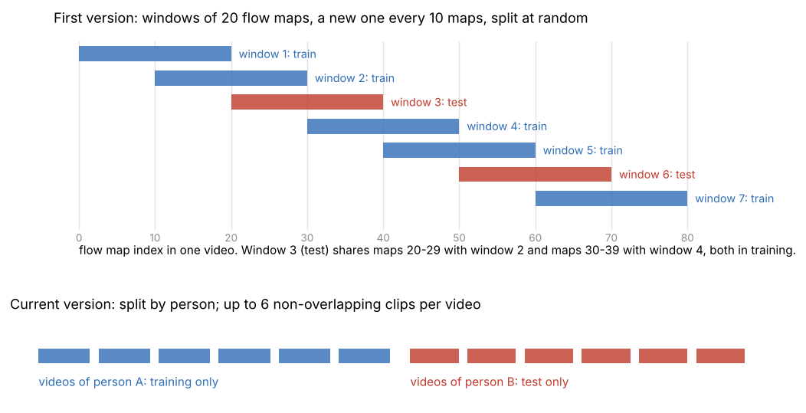

*Example of problem 1.* In the first version, a video of 80 flow maps gave 7 windows of 20 maps, a new
one every 10 maps. With a random split, window 3 could be in the test set while windows 2 and 4 were
in training: the 20 maps of window 3 had all been seen during training. Since the same person's other
videos were also in training, a model could score well simply by recognising people and scenes it had
already seen. In the current version, all videos of a person are on the same side, and the clips of a
video never overlap.

---

## 3. Preprocessing: decisions and reasons

All settings are saved in `preprocess_config.json` in each output folder; the script refuses to mix two
different settings in one folder, so a dataset can never be half-processed one way and half another.

| Setting | Value | Reason |
|---|---|---|
| Face detector | OpenCV **YuNet** (`face_detection_yunet_2023mar.onnx`), score ≥ 0.6, run on frames downscaled to 640 px on the longer side | Fast, included in OpenCV (no extra dependency), and it returns eye positions, which are used to measure how frontal a face is. Downscaling to 640 px keeps detection fast; boxes are converted back to full-resolution pixels. |
| Scan rate | **8 detections per second** | Detecting on every frame would be slow; faces move little in 1/8 s, so boxes in between are interpolated. |
| Tracking | a detection joins the track whose last box centre is nearest, if within **0.6 face widths** and seen in the last **3 scan frames** | Keeps one track per person even when the detector misses a few frames. |
| Main subject | the track with the **largest total area of frontal detections** | In interviews, a second person is often filmed from behind or from the side; they must not be taken for the subject. Frontal faces only count. |
| Frontality | distance between the eyes / face width, minimum **0.25** | Eyes far apart in the image = face turned towards the camera. Profile faces are rejected, since half the face (and half the swap) is hidden. |
| Minimum face width | **80 px** (DFD, Celeb-DF), **50 px** (FaceForensics++) | Smaller faces give blurry crops and unreliable flow. FaceForensics++ videos are often low resolution; at 80 px, 3 of the first 17 videos were rejected, at 50 px only 1 of its 1,000 real videos (§11, P5). |
| Inside the frame | the face box may exceed the frame by at most 5% of its size | A face half outside the frame would be mostly black padding. |
| Rival face | a frame is **ambiguous** if another face has frontality ≥ **0.30** and at least **50%** of the subject's area | The video's label belongs to one person. If two people of similar size face the camera, there is no automatic way to know which one was swapped, so those frames are not used. |
| Clip length | **21 consecutive frames → 20 flow maps** | Same sequence length as the first version, so the LSTM sees the same number of steps; consecutive frames because swap defects show between neighbouring frames (§2.2, problem 4). |
| Clips per video | up to **6**, **non-overlapping**, spread over the video | Several moments of each video, without the near-duplicate samples of the first version (§2.2, problem 1). |
| Frame rate | the video's own (option `--fps 5` reproduces the first version for comparison) | See §2.2, problem 4. |
| Crop box | linear interpolation between scan detections, **5-frame moving average**, square (larger side), enlarged ×**1.3** | Interpolation gives a box on every frame; smoothing removes the detector's jitter, which would otherwise appear as fake motion in the flow; the 1.3 margin keeps the edge of the face, where the blending seam of a swap usually lies. |
| Outside the frame | padded with **black** | Shifting the crop back inside the frame would move the face inside the crop, which creates false motion. |
| Crop size for RAFT | **256 × 256** | Enough detail for RAFT; RAFT needs sizes divisible by 8. |
| Stored size | **128 × 128** (flow and face images) | Same input size as the first version; 4 times less disk space and GPU memory than 256. |
| Storage | flow in **float16**, images in **uint8**, one `.flow.npy` and one `.rgb.npy` per video | float16 halves the disk space with negligible loss for motions of a few pixels. |
| Logging | one CSV line per video (usable or not, why, face size, time) and one preview image per video | Every exclusion is traceable; the previews allow a visual check that the right face was cropped. |
| Video selection | official test videos always included (`--must_include`), the rest a reproducible random sample (seed 42) | The official test sets stay complete; the subsample is the same every time. |

**Why crop the face at all?** Everything a face swap changes is inside the face region. In the whole
frame, the face is a small part and most of the flow describes the background and the camera, which
is the same in real and fake videos. Cropping makes the network look only where the evidence is.

**Why are some videos excluded?** A video yields no clip when, for 21 consecutive frames, the main face
is never usable: turned away, too small, out of the frame, or next to a second frontal face. These
videos are logged, counted (§10.0) and reported, not silently dropped.

### 3.1 Face scan and tracking, step by step

A face detector looks at **one picture** and answers "there are faces here, here and here", as boxes. It
does not know that the box in picture 10 and the box in picture 11 are the same person. Tracking is the
step that connects them.

1. **Scan.** Every third or fourth frame (about 8 per second), YuNet finds all the faces in the frame:
   a box for each, the position of the eyes, and a confidence score.
2. **Link.** The frames are visited in order. Each face found in a frame is compared with the people
   already known: if its centre is close to where one of them was last seen (less than 0.6 face widths
   away) and that person was seen in one of the last 3 scanned frames, the face is added to that
   person's list. Otherwise it starts a new person. Larger faces are linked first, so two people never
   take the same box.
3. **Choose the main subject.** Each person's list (their "track") gets a score: the total size of all
   their faces that look towards the camera. The person with the highest score is the main subject:
   the one who faces the camera the most and the largest, for the longest time.
4. **Check each scanned frame.** For the main subject, every scanned frame is marked usable or not
   (present, frontal enough, large enough, inside the picture, and not next to another frontal face of
   similar size; §3.3).

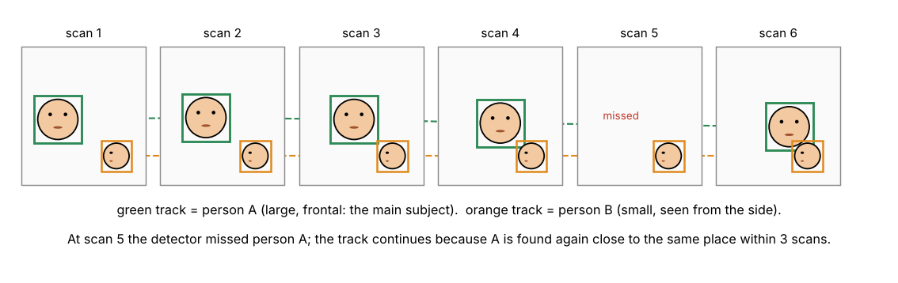

*Example.* In an interview, person A (the guest) faces the camera and person B (the interviewer) is
seen from the side. After linking, there are two tracks. A's faces are large and frontal, so A gets a
much higher score and becomes the main subject. At scan 5 the detector missed A for a moment; because
A is found again near the same place within 3 scans, the track simply continues instead of creating a
new person.

**In simple words.** Imagine a class photo taken every second during a break. A detector circles the
faces in each photo, but it does not know names. Tracking is like following each child from one photo
to the next by where they stand: "the child near the window in photo 1 is the child near the window in
photo 2". At the end, the child who looked at the camera the most is the one the video is about.

### 3.2 Clips: how they are chosen, with an example

A **clip** is a short piece of the video: 21 frames that follow each other with no frame skipped.

*Example.* A 10-second video at 25 frames per second has 250 frames. The scan finds the main face
usable from frame 20 to 110 and from 150 to 235; in between, the person turns away. The program lists
every possible start frame whose 21 frames lie entirely in a usable stretch, then picks 6 starts
spread evenly over those possibilities, never letting two clips share a frame. Here it gives 3 clips
in the first stretch and 3 in the second. A video with a shorter usable stretch gets fewer clips; a
video with no stretch of 21 usable frames is excluded and the reason is logged.

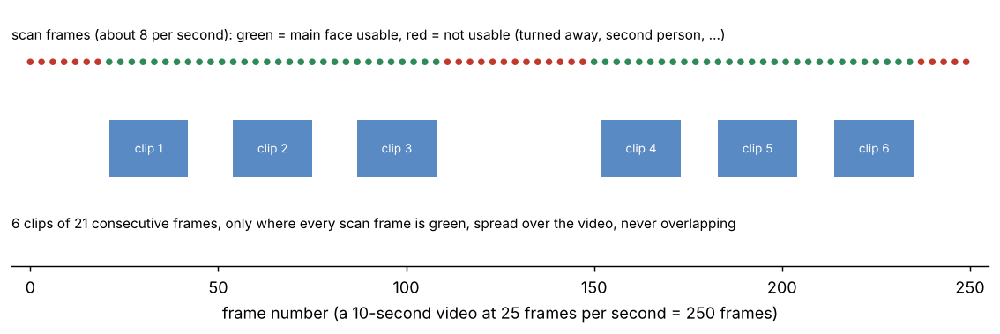

**Why 21 frames.** The detector compares each frame with the next one, so 21 frames give 20
comparisons (20 flow maps). At 25–30 frames per second this is about 0.7–0.8 seconds of video: long
enough to contain several small movements (a blink, a syllable, a slight turn), short enough that a
batch of 4 clips (80 flow maps and 80 face images) fits in the 6 GB of the graphics card during
training. It is also the sequence length of the first version, which keeps the comparison fair. The
value was chosen by this reasoning, not tuned; longer clips are a possible study.

**Why up to 6 clips per video.** One clip may happen to be easy or hard; 6 clips from different moments
give a steadier verdict for the video (the video's score is the average of its clips). 6 × 21 frames
is about 5 seconds per video, which keeps disk space and training time manageable for thousands of
videos.

**In simple words.** A video is like a long comic strip. The program cuts out 6 small pieces of 21
pictures each, only where the main person is clearly visible and alone, and never cuts the same
picture twice. Each piece is long enough to see a few small movements, and short enough for the
computer to handle many pieces at once.

### 3.3 Wrong crops and several people: what was seen, and how it was fixed

Before processing a whole dataset, the preprocessing was run on two small test folders and looked at
the preview image of every video (first and last frame of every clip). These problems showed up:

| What the previews showed | Why it happened | Fix |
|---|---|---|
| **The face slid out of the crop** during a clip, leaving half a face or the background | the crop box was fixed for the whole clip, while the person walked or turned | the box now follows the face: detections on about 8 frames per second, linked into a track, interpolated on every frame and smoothed over 5 frames |
| **The wrong person was cropped** in scenes with two people (for example an interviewer and a guest, or two actors) | the code took "a face", not "the face of the video's subject" | faces are linked into one track per person, and the main subject is the track with the largest total area of **frontal** faces over the whole video: the person facing the camera most of the time |
| **Two people both facing the camera** | the label "fake" belongs to the swapped person, and in such a frame there is no automatic way to tell which one it is | these frames are marked **ambiguous** (another face at least half the subject's size and frontality ≥ 0.30) and no clip may contain one. In the second test folder, a video with two people facing the camera was correctly excluded for this reason |
| **Profile views and faces turned away** | half of the face, and of the swap, is hidden | frames with frontality below 0.25 are not used |
| **Faces cut by the image border**, with a large black area in the crop | the person was at the edge of the picture | a face box may exceed the frame by at most 5% of its size |
| **Tiny, blurry faces** | the person was far from the camera, or the video was low resolution | faces narrower than 80 px are not used (50 px for FaceForensics++, §11, P5) |

Each problem in more detail:

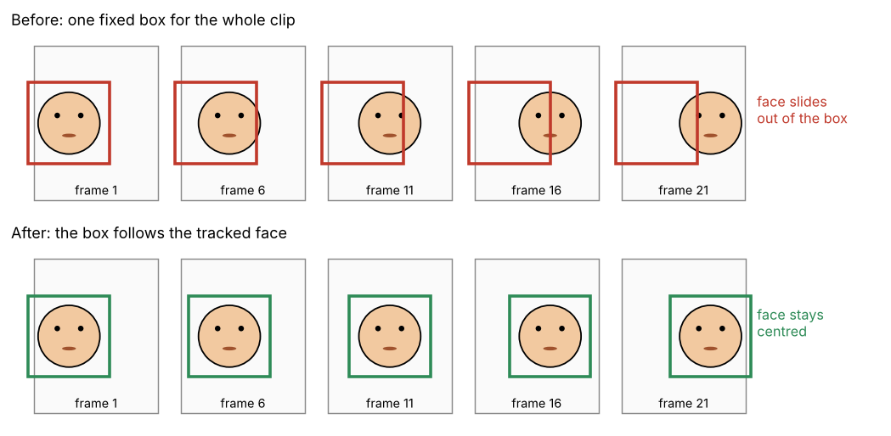

*Example 1, the face slides out of the box.* The first face-crop version of the new pipeline placed one
box per clip, from the first detection. In the test previews, when a person walked or turned during
the clip, the last frames showed half a face and part of the background. The optical flow of such a
clip describes the background appearing, not the face moving. With tracking, the box moves on every
frame and the face stays in the centre of the crop. (The first version of §2 had no crop at all: it
used the whole frame.)

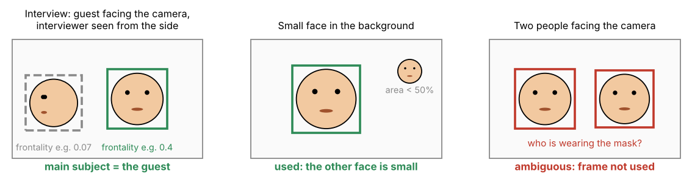

*Example 2, the wrong person.* The test previews showed crops of the wrong person in scenes with two
people. A typical case is an interview: the camera shows the interviewer from the side and the guest
from the front. Picking "a face" could pick the interviewer, who is not the swapped
person, so a fake video would be learned from a real face. The main-subject rule picks the person who
faces the camera most over the whole video: the guest.

*Example 3, two people facing the camera.* When two people of similar size both face the camera, there
is no automatic way to know which one wears the swapped face. Those frames are not used; a video made
only of such frames is excluded and logged as "ambiguous". This happened in the second test folder,
and it is the most common reason for exclusion in all three datasets.

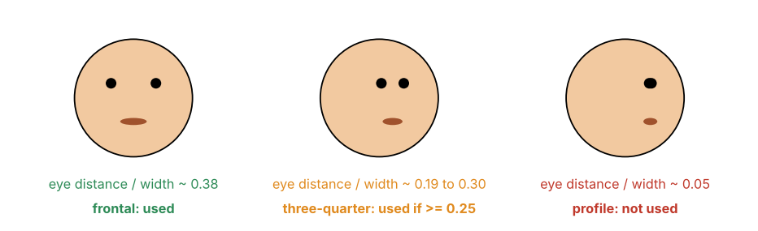

*Example 4, profiles.* A face seen from the side has its eyes close together in the image. The ratio
eye distance / face width measures this; below 0.25 the frame is not used. (The values in the figure
are examples.)

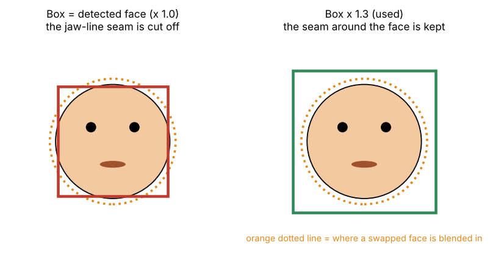

*Example 5, the margin.* A face swap replaces the inside of the face and blends it into the original
around the edge (jaw, cheeks, forehead). A crop exactly the size of the detected face cuts that edge
off; the 1.3 margin keeps it.

When no 21-frame stretch of a video passes all these rules, the video is excluded and the log records
why, with the number of scanned frames rejected for each reason (absent, profile, small, outside,
ambiguous). After each dataset these reasons were counted (§10.0)
and preview images were spot-checked again: in all three datasets most exclusions are
shots with two people facing the camera.

### 3.4 Why these numbers? (explained simply)

Imagine the video is a flip book. To decide whether a face is real or fake, the computer looks at a
few pages of the flip book and watches **how the face moves from one page to the next**. A fake face is
a mask pasted on someone; when the person moves, the mask sometimes slips or wobbles a tiny bit
between two pages. The numbers below decide which pages it looks at and how it cuts the face out.

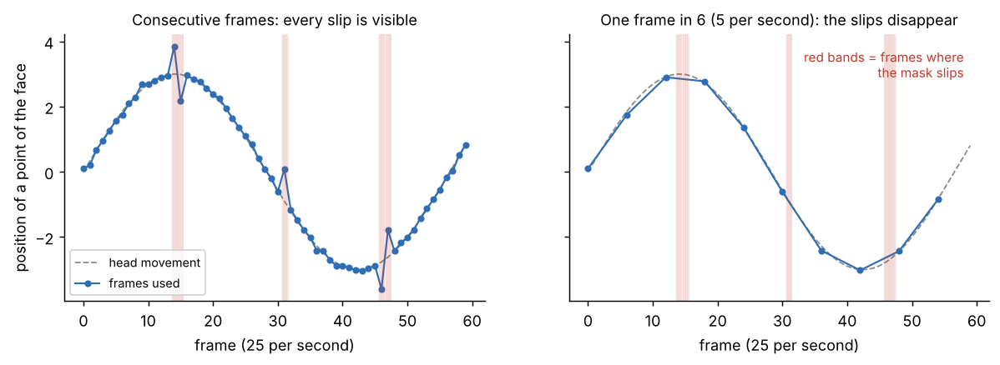

*Example: why consecutive frames.* The curve shows the position of one point of a face over 60 frames.
The head moves smoothly (dashed line), and the swapped face slips for a single frame 5 times (red
bands). Using every frame (left), each slip is a visible jump. Using one frame in 6, as the first
version did at 5 frames per second (right), most slips fall between two used frames and disappear.

| Number | What it is | Simple explanation | Why this value |
|---|---|---|---|
| **21 frames** (20 flow maps) per clip | length of one clip | the computer watches 21 pages in a row, and compares each page with the next one: 20 comparisons | at 25–30 frames per second, 21 frames are about 0.7–0.8 seconds: long enough to see several small movements (a blink, words being said), short enough to fit in the graphics card's memory with a batch of 4 clips. It is also the sequence length of the first version, so the LSTM sees the same number of steps |
| **Consecutive frames** (no skipping) | which pages are compared | it compares page 1 with page 2, page 2 with page 3... not page 1 with page 6 | the mask wobbles between neighbouring pages. If you skip pages, the wobble is hidden inside a big movement, like trying to see a fly on a fast train. The first version skipped 4–5 frames (5 per second) |
| **Up to 6 clips** per video, not overlapping | how many moments of a video are used | it looks at 6 different moments of the video, never the same pages twice | several moments make the video's decision more reliable (one clip may happen to be easy or hard); not overlapping so that no page is counted twice; 6 × 0.8 s ≈ 5 s of each video is used, which keeps disk space and training time manageable |
| **8 face checks per second** | how often the face is searched for | it looks for the face on about one page out of 3 or 4, and guesses where it is on the pages in between | a face cannot jump far in an eighth of a second, so the guess between two checks is accurate, and it is 3–4 times faster than checking every page |
| **0.6 face widths, 3 checks** (tracking) | how faces are linked into a person | if a face on the next check is close to where a face was (less than about half a face away), it is the same person, even if the detector missed them for up to 3 checks (about 0.4 s) | real people do not move more than half a face in an eighth of a second; allowing 3 missed checks keeps the same person when the detector blinks |
| **Frontality 0.25** | how much the face must look at the camera | the two eyes must be far enough apart in the picture: if you see someone from the side, their eyes look close together | 0.25 keeps faces turned partly away (three-quarter views) and rejects profiles, where half of the face is hidden |
| **0.30 and 0.5** (rival face) | when a second person makes a frame unusable | if another face is also looking at the camera and is at least half as big, the computer cannot know who is wearing the mask | a small face far behind, or a face seen from the side, does not cause confusion and is allowed; only a real competitor is |
| **80 px** (50 px for FaceForensics++) | smallest face width used | if the face is tiny, zooming it in makes it blurry, and you cannot see a mask slip on a blurry face | 80 px still holds enough detail once enlarged to 256 px; FaceForensics++ videos are lower resolution, and at 80 px too many good videos were lost, so 50 px is used there |
| **Smoothing over 5 frames** | steadying the crop box | the box around the face shakes a little because the detector is never exactly in the same place; averaging over 5 pages makes it steady | the shaking of the box would look like the face moving, a false wobble. 5 frames is about 0.2 s: enough to remove the shake, short enough to keep up with the real head movement |
| **Margin × 1.3** | how much around the face is kept | the box is made a bit bigger than the face, like leaving a border when you cut out a picture | the edge of the mask, where it is glued onto the real face (the jaw, the forehead, the cheeks), is the most likely place for a visible seam; a box exactly the size of the face would cut it off |
| **Black padding** outside the picture | what fills the crop when the face is near the edge | if part of the box is outside the picture, that part stays black instead of moving the box | moving the box would move the face inside the crop, which also looks like a false wobble |
| **256 × 256 for RAFT, 128 × 128 stored** | picture size | the face is cut out at 256 × 256 to measure the movement precisely, then stored at half size | RAFT needs sizes divisible by 8 and enough detail; 128 × 128 is the size the network reads (as in the first version) and needs 4 times less space |

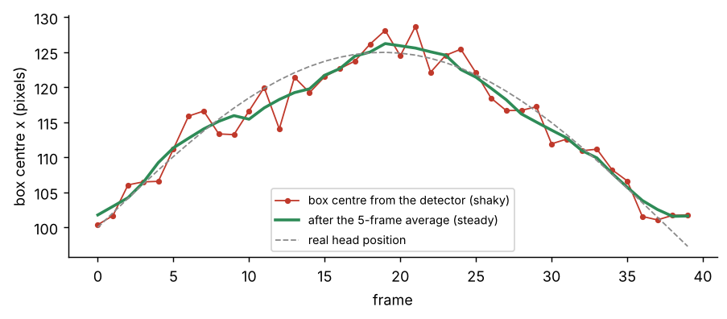

*Example: why smoothing.* The detector's box centre shakes by a few pixels from frame to frame even when
the head moves smoothly (red). Without smoothing, that shake would appear in the optical flow as the
face trembling, in real and fake videos alike. The 5-frame average (green) follows the head and
removes the shake.

How these values were chosen: by reasoning about the videos and the hardware, and by checking the
preview images; they were **not tuned** by trying many values and keeping the best scores. Changing
them (for example longer clips, or a different frame rate with `--fps`) is a possible study.

---

## 4. RAFT optical flow: what changed and why

**What optical flow is.** Optical flow answers one question for two pictures taken one after the
other: *where did each point of the first picture go in the second one?* The answer is a **flow map**:
for every pixel, two numbers, `dx` (how many pixels it moved left or right) and `dy` (how many up or
down). A flow map has the same size as the picture and two "channels", dx and dy, so it can be drawn as
an arrow on every point.

**What RAFT is.** RAFT (*Recurrent All-Pairs Field Transforms*, Teed and Deng, ECCV 2020) is a neural
network that computes optical flow. It compares every point of the first picture with every point of
the second, makes a first guess of the motion, and then improves that guess step by step (32
refinement steps here). It is one of the most accurate optical-flow methods available and its trained
weights are public. The weights used here (`raft-sintel`) were trained on Sintel, an animated film with
realistic, natural motion.

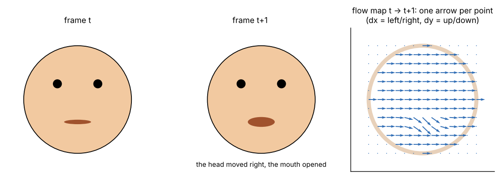

**How the 20 flow maps are used.** For each clip of 21 face crops, RAFT gives 20 flow maps: frame 1 →
2, 2 → 3, ..., 20 → 21. Each map is 2 × 128 × 128 numbers once stored. During training, each map has the
head's motion removed (§5), is scaled, and goes through the flow ResNet18, which turns it into 512
numbers describing its pattern of motion. The 20 descriptions, in order, go to the LSTM, which reads
them like the 20 steps of a short story and outputs a probability that the clip is fake (§6).

**What the result should look like.** On a real face, once the head's motion is removed, the
remaining flow is small and smooth: the mouth opens, the eyes blink, the cheeks move, and neighbouring
points move together. On a face swap, extra patterns may appear: the edge of the pasted face moving
differently from the skin around it, a mouth or eyes that drift slightly against the rest of the face,
or small flickers from one frame to the next. The network is not told what to look for; it learns
which patterns separate real from fake from the training examples.

**In simple words.** Put a tiny arrow on every freckle of a face in one picture, pointing to where that
freckle is in the next picture. All those arrows together are a flow map. RAFT is a program that draws
all those arrows very precisely. For a real face, the arrows of neighbouring freckles point the same
way. For a fake face, some arrows near the edge of the mask, the mouth or the eyes point a slightly
wrong way, and the detector learns to notice it.

**What changed compared with the first version:**

| | First version | Current version | Reason |
|---|---|---|---|
| Weights | Sintel | Sintel (unchanged) | Sintel is RAFT's model trained on realistic film scenes with natural motion, closer to video than the synthetic "Chairs/Things" data |
| Iterations | 32 | 32 (unchanged) | Standard setting, accurate |
| **Input range** | **0..1** (`ToTensor`) | **0..255** | RAFT expects 0..255 and maps it to −1..1 itself; 0..1 input gave near-black images (§2.2, problem 2) |
| Input images | whole frames, squashed to 256 × 256 | tracked face crops, 256 × 256 | §3 |
| Frame pairs | frames 0.2 s apart (5 fps) | consecutive frames | §2.2, problem 4 |
| Batch | 1 pair at a time | 10 pairs at a time | Faster on the GPU; 10 pairs fit in 6 GB |
| Precision | mixed precision | mixed precision, result converted to float32 before resizing | Avoids rounding in the resize |
| Resize | — | flow resized from 256 to 128 by bilinear interpolation, values kept in pixels of the 256 crop | Same units for every video; the scale is handled later (§5) |
| Storage | one file per flow map | one file per video, float16 | Thousands of small files are slow to read; one array per video loads in one step |

---

## 5. Removing the head's motion from the flow

**The problem.** In a flow map of a face crop, most of the motion comes from the head moving (turning,
nodding, getting closer) and from the crop window following it. That motion is the same in real and
fake videos. The motion that differs is small and inside the face: the mouth and eyes of a swapped
face may not move consistently with the rest, the skin may flicker, the blending edge may drift. The
large rigid motion hides these small signals.

**The method.** For each flow map, the horizontal and vertical motion are fitted as an **affine function
of the pixel position** (`dx ≈ a·x + b·y + c`, `dy ≈ d·x + e·y + f`, with x and y in [−1, 1]) by least
squares, and the fit is subtracted. An affine motion covers translation, in-plane rotation, zoom and
shear: exactly what the crop window's movement (translation and zoom) and most of a head's rigid
movement look like in a small crop. What remains is the **residual, non-rigid motion of the face**.
The fit uses a precomputed pseudo-inverse, so it costs almost nothing at training time.

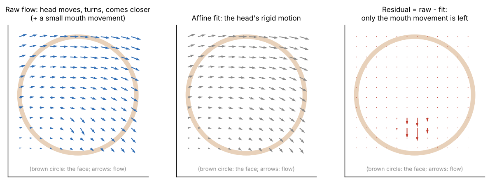

*Example.* The figure is made with the project's own `compensate_motion` on a constructed flow field:
the head moves to the right, turns a little and comes closer (left), and the mouth opens (a small
downward motion at the bottom of the face). The affine fit (middle) captures the head's motion; the
residual (right) is almost zero everywhere except at the mouth. That residual is what the network
receives.

**Step by step, with numbers.** Take one flow map: for every point (x, y) of the face crop, the motion
(dx, dy) measured by RAFT. Positions are written between −1 (left or top edge) and +1 (right or bottom
edge).

1. Suppose the whole head moves 3 pixels to the right between two frames. Every point has
   dx = 3, dy = 0. The best affine fit is simply "everything moves 3 to the right" (c = 3, all other
   coefficients 0). Subtracting it leaves 0 everywhere: nothing to see, as expected for a pure head
   movement.
2. Now the head also comes a little closer to the camera. Points on the right of the face move a bit
   more to the right, points on the left a bit to the left: dx grows with x (a > 0), dy grows with y
   (e > 0). This is a zoom, and the affine fit captures it too.
3. Now, in addition, the mouth opens: only the points of the mouth move 1 pixel down. The affine fit
   is computed over the whole face, so this small local movement barely changes it. After
   subtraction, every point is close to 0 **except the mouth**, which keeps its 1 pixel downward
   motion. That residual is what the network receives.

**What the six coefficients mean.** In `dx ≈ a·x + b·y + c` and `dy ≈ d·x + e·y + f`: `c` and `f` are a
shift left/right and up/down; `a` and `e` a stretch (zoom in or out); `b` and `d` a rotation or a
shear. Together they describe how a flat picture can move as one piece, which is how a face crop moves
when the head moves and the crop window follows it.

**Mathematical formulation.** A 128 × 128 flow map holds N = 16,384 vectors (dx_i, dy_i). The design
matrix A (N rows, 3 columns) has row i equal to [x_i, y_i, 1], with x_i and y_i the point's coordinates
scaled to [−1, 1]. The least-squares coefficients are θ_x = A⁺ · dx and θ_y = A⁺ · dy, where
A⁺ = (Aᵀ A)⁻¹ Aᵀ is the Moore-Penrose pseudo-inverse of A. The grid is the same for every map, so A⁺
(3 × 16,384) is computed once and cached; each fit is two matrix-vector products. The residual given to
the network is r_x = dx − A · θ_x and r_y = dy − A · θ_y. With `mean`, the residual is simply
r_x = dx − mean(dx) and r_y = dy − mean(dy); with `none`, r = d.

**Three settings** are kept for comparison (`--motion`):
- `none`: raw flow;
- `mean`: subtract only the mean displacement (only `c` and `f`: translation);
- `affine`: subtract the full affine fit (all six coefficients).

**What the experiments showed** (§10.5): removing only the mean displacement generalised best to the
unseen datasets (0.870 on DFD and 0.739 on Celeb-DF, against 0.820 and 0.719 for the affine removal
and 0.824 and 0.687 without removal). A likely explanation, still to be tested: the affine fit also
removes part of the useful signal. A jaw that drops or cheeks that stretch move many points of the
face in a zoom-like or rotation-like way, so the affine fit treats part of them as "head motion" and
subtracts them. Removing only the translation takes away the sliding of the head and crop window,
which is the largest and least informative part, and keeps everything else. These results come from
one training run per setting and need repeating with more seeds.

**In simple words.** When someone walks while talking, their whole face slides across the picture. That
big slide is the same for real and fake faces, and it hides the tiny slips of a mask. Removing the head
motion is like holding the camera so that the face stays still in the picture, so that only the small
movements inside the face remain: the mouth, the eyes, and possibly the mask slipping. The experiments
show that it is better to remove only the sliding, and not try to remove every kind of head movement,
because that also removes some of the face's own movements.

**Scaling.** Instead of standardising each map on its own (§2.2, problem 5), every flow map is divided
by **one number for the whole dataset**: the root mean square of the compensated flow over 200 random
training clips (seed 42). This keeps a still face and a moving face distinguishable. The number is
computed on training clips only and stored in the checkpoint, so validation, test and cross-dataset
data use exactly the same scale.

**Flip augmentation.** In training, a clip is mirrored left–right with probability 0.5. For the flow,
the maps are mirrored **and dx is negated**, because a motion to the right becomes a motion to the left in a
mirror image. The face images are mirrored the same way.

---

## 6. The network: ResNet18 and LSTM changes and why

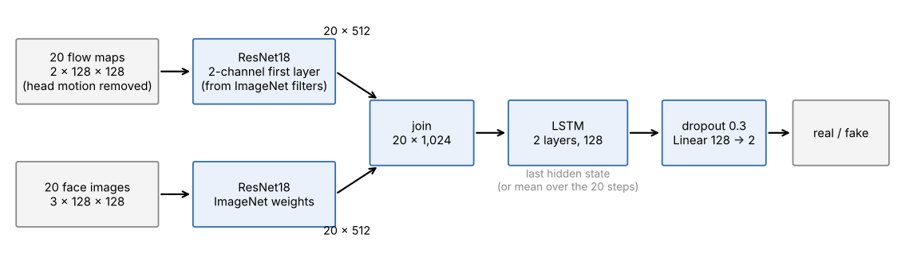

| Part | First version | Current version | Reason |
|---|---|---|---|
| Flow encoder, first layer | new random 2-channel convolution | 2-channel convolution **initialised from the ImageNet filters**: each new filter = the pretrained filter averaged over its 3 colour channels, copied to both flow channels | The layer starts from trained edge and texture detectors, consistent with the pretrained layers above it (§2.2, problem 6) |
| Flow encoder, last layer | new random `Linear(512, 512)` | removed (`Identity`): the 512 pooled features go straight to the LSTM | One less layer to learn from scratch, nothing lost (§2.2, problem 7) |
| Appearance stream | none | a second ResNet18 (ImageNet weights) on the face image of each step; images divided by 255 and normalised with the ImageNet mean and standard deviation | Flow shows how the face moves; the image shows what it looks like (textures, blending edges, colour mismatches). Published detectors mostly rely on appearance. Having both makes it possible to measure what each adds (§10.5). Frame *t* is paired with the flow from *t* to *t*+1. |
| Fusion | — | the two 512-value features of each step are joined (1,024 values) | Simple and transparent: the LSTM sees both at every step |
| LSTM | 2 layers, hidden 128, dropout 0.1 between layers, last hidden state | unchanged | Already reasonable; keeping it makes the comparison with the first version cleaner |
| Dropout before classifier | 0.2 | 0.3 | The input is now twice as large (1,024 values) and the model overfits quickly (§10.2) |
| Classifier | Linear(128, 2) | unchanged | |
| Temporal head (option) | — | `--temporal mean`: average of the 20 step features, no LSTM | To test whether the order of the steps matters (§10.5) |
| Mode (option) | flow only | `--mode two_stream`, `flow` or `rgb` | To measure each stream's contribution (§10.5) |

**Model size** (trainable parameters, counted on the code):

| Version | Parameters |
|---|---|
| Two streams + LSTM (full model) | 23,073,090 |
| Two streams + mean over time | 22,351,938 |
| Flow only + LSTM | 11,634,434 |
| Images only + LSTM | 11,637,570 |

Each ResNet18 without its classification layer has about 11.2 million parameters; the LSTM and the
classifier about 0.7 million. A `best.pth` file takes about 92 MB (45 MB for a one-stream version).

**What each part does.**
- **ResNet18** is a standard image-recognition network with 18 layers, here pretrained on ImageNet (1.2
  million photos). It turns one picture into 512 numbers that describe what it contains. One copy
  reads the flow map of each step, another the face picture of each step.
- **LSTM** (*long short-term memory*) is a network that reads a sequence one step at a time and keeps a
  memory of what it has seen. It reads the 20 steps of a clip in order and, at the end, its memory
  holds a summary of the whole clip, from which the final layer gives "real" or "fake".

**Why two streams.** The flow and the face picture carry different evidence. The flow shows *how* the
face moves (§4); the picture shows *what it looks like*: blending edges, blur, skin texture, colour
differences between the pasted face and the neck. Most published detectors rely on appearance alone;
this project's question is whether motion adds something. A two-stream design, introduced for action
recognition by Simonyan and Zisserman (2014), is the simplest way to combine both and, more importantly
here, to measure each one: the same network can be trained with only one stream (`--mode flow` or
`--mode rgb`) and compared.

**Is it the best design?** Not proven, and the results say it is not clearly better than appearance
alone:
- On DFD, the two streams together score 0.820 against 0.798 for images only, and 0.870 with mean
  motion removal: here motion helps.
- On Celeb-DF, images alone score 0.738 against 0.719 for the full model; the difference is inside
  the intervals.
- Flow alone generalises poorly (0.596 on Celeb-DF).

So the two-stream network is a reasonable, transparent choice that allowed these measurements, not a
demonstrated optimum. Stronger alternatives exist in the literature: fusing the two streams later or
with attention, 3D convolutional networks that read many frames at once, or video transformers. The
best published results on Celeb-DF (for example AltFreezing and PhaseForensics, §10.4) use such
designs.

**In simple words.** The detector has two pairs of eyes. One pair looks at the photos of the face, like
checking whether a mask has visible edges. The other pair looks only at the arrows of movement, like
checking whether the mask slides. A third part, the LSTM, watches both pairs of observations one moment
after another, like reading a comic strip, and decides at the end whether the face was real. Having two
pairs of eyes made it possible to test which one is more useful.

---

## 7. Training: hyperparameters and reasons

| Setting | First version | Current version | Reason |
|---|---|---|---|
| Optimiser | AdamW | AdamW | unchanged |
| Learning rate | 1e-4 | 1e-4 | unchanged; standard for fine-tuning pretrained ResNets |
| Weight decay | 1e-4 | 1e-4 | unchanged |
| Batch size | 4 | 4 | GPU memory (6 GB): one clip = 20 flow maps + 20 images |
| Gradient accumulation | 4 | 4 (effective batch 16) | unchanged; the last incomplete group of batches in an epoch is now also applied (the first version skipped it) |
| Mixed precision | yes | yes | faster, less memory |
| Loss | cross-entropy | **class-weighted** cross-entropy, weight of class c = n / (2 × n_c) on the training set | DFD has about 2.7 fakes per real video, FaceForensics++ (as used here) 1.2; without weights the model leans towards "fake" |
| Epochs | up to 15 | up to **30** | room to converge; early stopping usually ends much earlier |
| Early stopping | patience 3 | patience **5** | validation scores jump from epoch to epoch (§10.2); 3 stopped too early on noise |
| Model selection | clip F1 at 0.5 | **video-level AUC on validation** | AUC does not depend on a threshold and is the metric of the article; video level matches the decision being made |
| Decision threshold | 0.5 | **chosen on validation videos** (maximum of true-positive rate − false-positive rate, Youden's J), stored in the checkpoint | at 0.5, real actors with scores of 0.52–0.62 became false alarms (§10.1) |
| Augmentation | none | horizontal flip, p = 0.5 (§5) | the only augmentation for now; more is planned (§15) |
| Seed | partial | **42** for Python, NumPy, PyTorch and each data-loading worker; deterministic cuDNN | runs can be repeated exactly (confirmed in §10.1) |
| Data workers | 2 | 2 | |

**In simple words.** Training is like a pupil doing exercises and checking the answers. One **epoch**
is one pass through all the training exercises. After each exercise the network adjusts its settings a
little in the direction that would have given a better answer; the **learning rate** (0.0001) is how big
each adjustment is, kept small so that it does not overshoot. The **loss** measures how wrong the answers
were, with fake and real counting equally even though there are more fakes. After each epoch, the
network takes a test on videos it does not train on (the validation set); the best epoch on that test
is kept, and training stops when 5 epochs in a row bring no improvement (**early stopping**), because
from then on the pupil is memorising the exercises rather than learning. The **seed** fixes all the
random choices, so the same run gives exactly the same result again.

---

## 8. Evaluation protocol

- **No identity on both sides of a split.** DFD and Celeb-DF are split by identity (the part of the
  file name before the first `_`: the DFD actor, the Celeb-DF celebrity). FaceForensics++ uses its
  official split of source videos (fake `000_003` stays with real videos `000` and `003`). The code
  checks this after every split and stops if it is broken.
- **Videos are split, never clips.** All clips of a video are on the same side.
- **DFD:** 7-fold cross-validation grouped by actor and stratified by class (scikit-learn
  `StratifiedGroupKFold`, seed 42); in each fold, about 15% of the training actors are held out for
  validation. Every video is tested exactly once, by a model that never saw that actor.
- **Celeb-DF:** the official list of 518 test videos.
- **FaceForensics++:** the official 720 / 140 / 140 split.
- **Metrics,** with "fake" as the positive class: AUC, accuracy, balanced accuracy, precision, recall,
  F1, false-alarm rate (real videos called fake) and confusion matrix, at clip level and at video
  level (mean of the clip probabilities). For the video AUC, a 95% interval from 1,000 bootstrap
  resamples of the test videos.
- **Cross-dataset:** a trained model is tested unchanged on another dataset (same flow scale, same
  threshold, no retraining). Results are reported as AUC, because a threshold chosen on one dataset does
  not transfer to another (§10.3).

**In simple words.**
- **Splits.** The videos are divided into three groups: one to learn from (training), one to choose the
  best version and the decision rule (validation), and one used only once at the very end (test). A
  person who appears in one group never appears in another, so the detector cannot pass the test by
  recognising faces it has already seen.
- **7-fold cross-validation.** The DFD actors are divided into 7 groups; the detector is trained 7
  times, each time tested on a different group, so every video is tested once and no single lucky group
  decides the result.
- **AUC.** The detector gives every video a score between 0 (surely real) and 1 (surely fake). The AUC
  is the chance that a randomly chosen fake video gets a higher score than a randomly chosen real one:
  1.0 is perfect, 0.5 is a coin toss. It does not depend on where the line between "real" and "fake" is
  drawn.
- **Threshold.** To give a yes/no answer, a line must be drawn: above it, "fake". The line is placed
  where it separates the validation videos best, never by looking at the test videos.
- **95% interval.** The test is repeated 1,000 times on random re-draws of the test videos to see how
  much the AUC would change with slightly different videos; the true value very likely lies inside the
  interval. When the intervals of two versions overlap a lot, the difference between them may be luck.

**Formal definitions.**
- *Loss.* For a batch of n clips with labels y_i ∈ {real, fake} and predicted probabilities p_i,
  L = − Σ_i w_{y_i} · log p_i(y_i) / Σ_i w_{y_i}, with w_c = n_total / (2 · n_c) computed on the training
  clips (n_c: number of clips of class c). This is PyTorch's weighted cross-entropy.
- *Video score.* P_v = (1 / K_v) · Σ_k p_k(fake), the mean "fake" probability of its K_v clips (K_v ≤ 6).
- *AUC.* With n₊ fake and n₋ real videos, AUC = (1 / (n₊ · n₋)) · Σ_i Σ_j [ 1(P_i > P_j) + ½ · 1(P_i = P_j) ],
  i over the fakes and j over the real videos (the Mann-Whitney statistic); computed with scikit-learn.
- *Threshold.* τ* = argmax_τ [ TPR(τ) − FPR(τ) ] over the ROC points of the validation videos (Youden's
  J), TPR being the share of fakes detected and FPR the share of real videos called fake. Maximising J is
  the same as maximising the balanced accuracy (TPR + TNR) / 2.
- *Bootstrap interval.* 1,000 draws with replacement of the set of test videos (same size, seed 0), AUC
  recomputed on each draw; the interval runs from the 2.5th to the 97.5th percentile (percentile
  interval). The rare draws with only one class are skipped.
- *Flow scale.* s = sqrt( (1/M) · Σ r² ), the sum running over every value (2 channels, 20 maps,
  128 × 128 points) of 200 random training clips (seed 42); M is the number of values. The network
  input is r / s.

---

## 9. Datasets

Three public datasets are used. They must be requested from their authors and are not included in the
repository. All three are used in their **c23** version where it exists: videos compressed with H.264 at
a constant rate factor of 23, a light compression close to what video platforms deliver.

### 9.1 DFD (DeepFakeDetection, Google and Jigsaw, 2019)

- **What it is.** Paid actors who gave their consent were filmed in 16 everyday scenes (talking against
  a wall, walking down a hall, a kitchen, a meeting, hugging, and so on). The fakes were made with a
  face-swap method: in each fake, one actor's face is replaced by another actor's.
- **Size.** 363 real videos of 28 actors, 3,068 fakes.
- **Structure.** Distributed with FaceForensics++:
  - real: `original_sequences/actors/c23/videos/01__exit_phone_room.mp4` (actor 01, scene "exit phone
    room");
  - fake: `manipulated_sequences/DeepFakeDetection/c23/videos/02_03__walking_outside_cafe_disgusted__QH3Y0IG0.mp4`
    (a video of actor 02 in that scene, with the face of actor 03; the last part is an identifier).
- **Identity used for splitting.** The number before the first `_` (the actor in the original video), so
  that all videos of one actor, real and fake, stay on one side.
- **Used here.** All 363 real videos and 1,000 fakes (random sample, seed 42); 354 real and 956 fake
  videos usable (§10.0).

### 9.2 Celeb-DF v2 (Li et al., CVPR 2020)

- **What it is.** Interviews of celebrities from YouTube, and face swaps between them made with an
  improved method designed to reduce visible defects (colour mismatch, flicker, blurry edges). It is
  known as a hard test set.
- **Size.** 590 real videos of 59 celebrities (`Celeb-real`), 300 more real YouTube videos
  (`YouTube-real`), 5,639 fakes (`Celeb-synthesis`).
- **Structure.**
  - `Celeb-real/id0_0000.mp4`: video 0000 of celebrity 0;
  - `Celeb-synthesis/id0_id1_0000.mp4`: the same video 0000 of celebrity 0, with the face of
    celebrity 1;
  - `YouTube-real/00000.mp4`: an extra real video;
  - `List_of_testing_videos.txt`: the official test set, 518 lines of the form `1 Celeb-real/id0_0004.mp4`
    (in this file, 1 = real and 0 = fake).
- **Identity used for splitting.** The text before the first `_` (`id0`), so a celebrity's real videos
  and the fakes built on them stay together.
- **Used here.** As an unseen test set: the official 518 test videos (510 usable). All 890 real videos
  and 1,500 fakes (including the 340 test fakes) were preprocessed.

### 9.3 FaceForensics++ (Rössler et al., ICCV 2019)

- **What it is.** 1,000 YouTube videos, mostly news and interviews with one clearly visible face. Each
  video was manipulated with 4 methods:
  - **Deepfakes**: face swap with a neural network (autoencoder);
  - **FaceSwap**: face swap with a 3D face model and computer graphics;
  - **Face2Face**: the face is kept, but its expressions are replaced by those of another video
    (graphics-based);
  - **NeuralTextures**: the expressions, mainly the mouth, are re-rendered with a neural network.
- **Size.** 1,000 real videos and 1,000 fakes per method (4,000 fakes).
- **Structure.**
  - real: `original_sequences/youtube/c23/videos/000.mp4`;
  - fake: `manipulated_sequences/Deepfakes/c23/videos/000_003.mp4` (video 000 with the face, or the
    expressions, of video 003); the same names exist for every method, so in this project they are
    stored as `DF-000_003`, `F2F-000_003`, `FS-000_003`, `NT-000_003`;
  - official split: `train.json`, `val.json`, `test.json`, lists of pairs of video numbers (720 / 140 /
    140 videos).
- **Identity used for splitting.** The official split, which keeps the two videos of each pair on the
  same side.
- **Used here.** For training: 1,000 real videos and 500 fakes per method (all 280 validation and test
  fakes of each method plus 220 training fakes); 991 real and 1,976 fake videos usable.

| Dataset | Real | Fake | Fake methods | Role here |
|---|---|---|---|---|
| DFD | 363 | 3,068 | 1 face swap | training (7-fold) and unseen test |
| Celeb-DF v2 | 890 | 5,639 | 1 improved face swap | unseen test (official list) |
| FaceForensics++ | 1,000 | 4,000 | 2 face swaps, 2 expression edits | training (official split) |

**In simple words.** The detector learns from examples, like a pupil learning to spot forged banknotes
by looking at many real and forged notes. FaceForensics++ is the main schoolbook: forgeries made four
different ways. DFD and Celeb-DF are surprise exams made by other forgers with other tools: they show
whether the pupil really understood what makes a forgery, or only memorised the schoolbook.

## 10. Results

**How to read the numbers.** All scores are **AUC** (§8): 1.0 means every fake video is scored above
every real one, 0.5 means no better than a coin toss. "Seen dataset" results (training and test from
the same dataset, different people) show how well the detector learned that kind of fake. "Unseen
dataset" results (a dataset never used in training) show whether it learned something general; they are
the ones that matter for real use. The numbers in brackets are 95% intervals.

### 10.0 Preprocessing: usable videos

| Dataset | Real usable | Fake usable | Main reasons for exclusion |
|---|---|---|---|
| DFD | 354 / 363 | 956 / 1,000 | two people in the shot, face turned away, too short |
| Celeb-DF | 863 / 890 | 1,483 / 1,500 | no usable frontal face for 21 frames, two people |
| FaceForensics++ | 991 / 1,000 | 1,976 / 2,000 (494 per method) | two people in the shot |

Celeb-DF official test list: 510 of 518 videos usable (107/108 Celeb-real, 67/70 YouTube-real,
336/340 fakes). FaceForensics++ test set: 695 of 700 usable (139 real, 556 fake). All results on these
sets are on the usable videos.

Processing time: about 8 s per video for DFD, 4.6 s for Celeb-DF, 6–8 s for FaceForensics++.

### 10.1 DFD, single split (first run)

Test actors 02, 05, 18, 27 (51 real, 144 fake videos); best epoch 17 of 20; about 2 minutes per epoch.

| Level | AUC | At threshold 0.5 |
|---|---|---|
| Clip | 0.964 | |
| Video | **0.984** (95% CI 0.966–0.996) | accuracy 0.923, balanced accuracy 0.878, 11/51 false alarms, 4/144 fakes missed |

The 11 false alarms (8 of them from actor 27, scores 0.52–0.62) led to choosing the threshold on
validation videos (§7). A single split with only 4 test actors is also too fragile a basis for
conclusions, which led to the 7-fold protocol. This split turned out to be fold 1 of the 7-fold run
below, and gave the same result to four decimals, which confirms the runs are reproducible.

### 10.2 DFD, 7-fold cross-validation by actor

| Fold | Video AUC | 95% CI | False alarms* | Fakes missed* |
|---|---|---|---|---|
| 1 | 0.984 | 0.966–0.996 | 0 / 51 | 15 / 144 |
| 2 | 0.958 | 0.927–0.983 | 9 / 50 | 8 / 129 |
| 3 | 0.963 | 0.933–0.986 | 2 / 52 | 9 / 131 |
| 4 | 0.989 | 0.971–0.999 | 1 / 54 | 8 / 146 |
| 5 | 0.945 | 0.912–0.973 | 5 / 54 | 15 / 132 |
| 6 | 0.977 | 0.955–0.994 | 1 / 45 | 24 / 144 |
| 7 | 0.990 | | 4 / 48 | 2 / 130 |
| **All** | **0.972 ± 0.017** | | **22 / 354 (6.2%)** | **81 / 956 (8.5%)** |

\*At the threshold chosen on validation. Balanced accuracy over all 1,310 videos: 0.927. On the first six
folds, the fixed 0.5 threshold gave 51 false alarms instead of 18.

**Overfitting check.** At the last epoch, training accuracy reaches 97–99% and the training loss
0.02–0.09, while the validation loss is 0.25–0.48, 3 to 20 times higher (curves in §10.8). The best
epoch was the 3rd in three folds, and the 4th, 6th, 7th and 17th in the others. The model fits its training
videos much better than new ones; early stopping on validation AUC keeps the test scores honest, but
it shows that DFD is easy to learn, which is a warning for generalisation.

### 10.3 Trained on DFD, tested on Celeb-DF (unseen dataset)

| DFD model | Celeb-DF video AUC | 95% CI | False alarms at the DFD threshold |
|---|---|---|---|
| Fold 1 | 0.780 | 0.734–0.820 | 46.6% |
| Fold 2 | 0.767 | 0.724–0.809 | 54.0% |
| Fold 3 | 0.808 | 0.767–0.845 | 53.5% |
| Fold 4 | 0.742 | 0.697–0.789 | 22.4% |
| Fold 5 | 0.743 | 0.692–0.786 | 50.6% |
| Fold 6 | 0.822 | 0.783–0.859 | 27.0% |
| Fold 7 | 0.805 | 0.765–0.844 | 44.3% |
| **Mean** | **0.781 ± 0.032** | | |
| Average of the 7 models' scores | 0.828 | 0.791–0.865 | (7-model ensemble, not comparable with single models) |

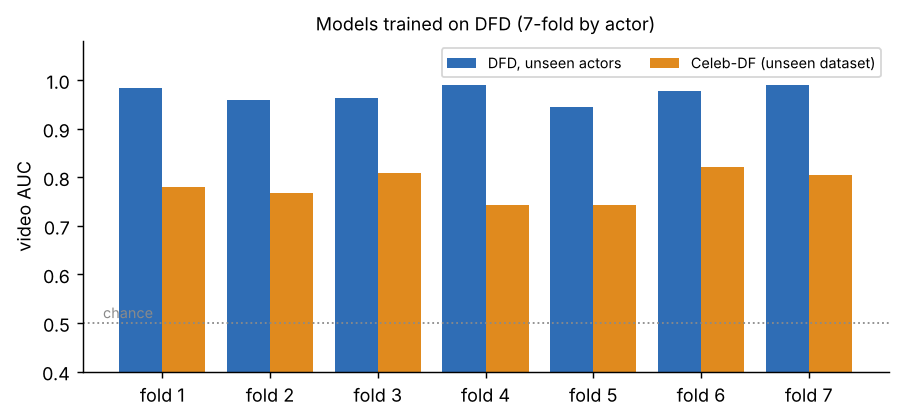

What this shows:
- AUC drops from 0.972 on DFD to 0.781 on Celeb-DF: part of what the model learned is specific to DFD
  (one set of studio scenes, one fake method, one compression level).
- It still carries over clearly above chance (0.5): the model learned something general too.
- The threshold does not carry over: false alarms of 22–54% on Celeb-DF. Cross-dataset results must be
  read as AUC.

### 10.4 Trained on FaceForensics++, full model

Training 1,582 videos (714 real, 868 fake), validation 690, test 695. Best epoch 6 (validation video
AUC 0.956); training stopped after epoch 11. About 4.5 minutes per epoch.

| Tested on | Video AUC | 95% CI | Clip AUC |
|---|---|---|---|
| FaceForensics++ test | **0.967** | 0.955–0.977 | 0.940 |
| DFD (unseen) | **0.820** | 0.799–0.842 | 0.791 |
| Celeb-DF (unseen) | **0.719** | 0.672–0.764 | 0.701 |

On the FaceForensics++ test set at the validation threshold: 6/139 false alarms (4.3%), 77/556 fakes
missed (13.8%), balanced accuracy 0.909.

Published detectors trained on FaceForensics++ (AUC as reported by their authors; references in §19):

| Method | Celeb-DF | DFD |
|---|---|---|
| PhaseForensics | 0.912 | |
| AltFreezing | 0.895 | 0.985 |
| FTCN | 0.869 | 0.944 |
| RealForensics | 0.869 | |
| LipForensics | 0.824 | |
| Das et al. 2023 (images + optical flow, trained on FF++ c40) | 0.802 | |
| GC-ConsFlow 2025 (optical-flow residuals) | 0.759 | |
| **This project, full model** | **0.719** | **0.820** |
| **This project, mean motion removal (§10.5)** | **0.739** | **0.870** |

This comparison is indicative: the protocols are not identical (compression level of the training
videos, frame- or video-level AUC, number of fakes used, videos excluded by preprocessing), and none of
these methods was retrained here under the same conditions.

Honest reading: on unseen data the full model is currently below published methods, and on Celeb-DF
below the DFD-trained models of §10.3. Likely reasons, not yet tested: only half of the FaceForensics++ fakes
were used (500 of 1,000 per method), there is no augmentation besides flipping (published methods
train on blurred, recompressed and colour-shifted copies), and the model reaches its best validation
score very early (epoch 6) and then fits FaceForensics++ more and more.

### 10.5 Ablations on FaceForensics++

Video AUC with 95% interval.

Each version changes one thing compared with the full model; everything else is identical.

| Version | Question | FF++ test | DFD | Celeb-DF |
|---|---|---|---|---|
| Full model | main result | 0.967 (0.955–0.977) | 0.820 (0.799–0.842) | 0.719 (0.672–0.764) |
| Images only (`--mode rgb`) | does the flow add anything? | 0.939 (0.920–0.955) | 0.798 (0.772–0.825) | 0.738 (0.692–0.785) |
| Flow only (`--mode flow`) | can motion alone detect fakes? | 0.980 (0.970–0.988) | 0.681 (0.647–0.711) | 0.596 (0.549–0.646) |
| No head-motion removal (`--motion none`) | does removing the head's motion help? | 0.971 (0.960–0.981) | 0.824 (0.799–0.849) | 0.687 (0.639–0.734) |
| Mean removal only (`--motion mean`) | is the affine removal better than removing the mean? | 0.957 (0.942–0.970) | **0.870** (0.850–0.891) | 0.739 (0.691–0.786) |
| Mean over time (`--temporal mean`) | does the LSTM help? | **0.986** (0.979–0.992) | 0.790 (0.763–0.814) | **0.748** (0.700–0.790) |

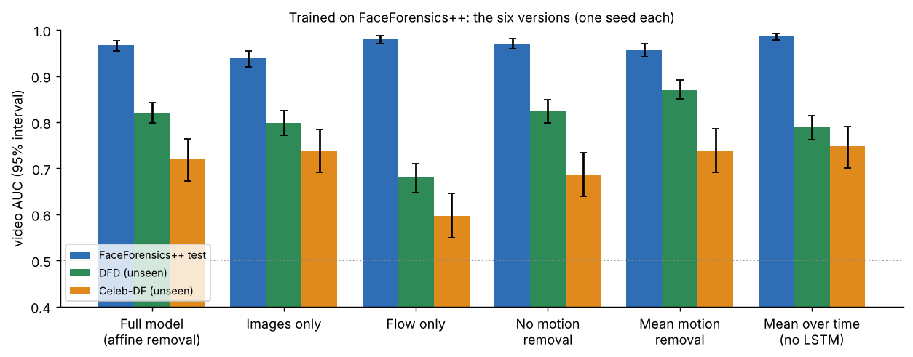

Celeb-DF intervals are about ±0.045 wide, so a difference of a few hundredths between two versions can
be chance; a claim will need 2–3 seeds.

**Reading of the six versions** (one seed each; Celeb-DF intervals are about ±0.045 wide, DFD
about ±0.02).
- *Flow and images together* help on DFD (0.820 against 0.798 for images only) but not on Celeb-DF
  (0.719 against 0.738). Both differences are inside the intervals.
- *Flow alone* is among the best on FaceForensics++ (0.980) and by far the worst on unseen data (0.681
  on DFD, 0.596 on Celeb-DF): the motion it learns is largely specific to how FaceForensics++ fakes
  were made.
- *Removing the head's motion: how much.* No removal, removal of the mean displacement, and the full
  affine removal give 0.824, **0.870** and 0.820 on DFD, and 0.687, **0.739** and 0.719 on Celeb-DF.
  Removing only the mean displacement (the translation of the head and of the crop window) is the best
  of the three on both unseen datasets; on DFD its interval (0.850–0.891) does not overlap the affine
  one (0.799–0.842). A possible interpretation, not yet tested: removing some motion helps, but the affine fit
  also removes useful signal (zoom-like and rotation-like movements of the jaw and cheeks that are
  spread over the face), while the translation alone removes mostly the head and crop movement. This
  is the opposite of what was expected when the affine removal was designed, and it is the main finding of
  the ablations.
- *Mean over time instead of the LSTM* is the best on FaceForensics++ (0.986) and on Celeb-DF (0.748,
  inside the intervals of the others), but lower on DFD (0.790). The LSTM does not show a clear,
  consistent benefit.
- Across versions, the score on FaceForensics++ says little about the score on unseen datasets: the
  two versions that fit FaceForensics++ best (mean over time, 0.986, and flow only, 0.980) are not the
  best on DFD, and flow only is the worst on both unseen datasets. Model selection on the training
  dataset alone cannot find the best generaliser.
- All of this is one seed per version. The two comparisons to repeat with 2–3 seeds are mean against
  affine motion removal, and LSTM against mean over time.

### 10.6 Results per manipulation method (FaceForensics++ test)

Each manipulation method is evaluated on its own: the 139 test fakes of the method against the 139 real
test videos. Video AUC, computed afterwards from the `test_predictions.csv` files (95% intervals from
1,000 bootstrap draws).

| Version | Deepfakes | Face2Face | FaceSwap | NeuralTextures |
|---|---|---|---|---|
| Full model | 0.981 (0.966–0.994) | 0.969 (0.951–0.984) | 0.988 (0.976–0.996) | 0.929 (0.899–0.955) |
| Images only | 0.973 | 0.946 | 0.927 | 0.909 |
| Flow only | 0.994 | 0.986 | **1.000** | 0.939 |
| No motion removal | 0.975 | 0.978 | 0.992 | 0.939 |
| Mean motion removal | 0.982 | 0.958 | 0.977 | 0.912 |
| Mean over time | **0.991** | **0.988** | 0.999 | **0.965** |

Fakes missed by the full model at the validation threshold: 7.2% (Deepfakes), 18.0% (Face2Face), 5.8%
(FaceSwap), 24.5% (NeuralTextures).

Reading:
- **NeuralTextures is the hardest method for every version** (0.909 to 0.965), most often followed by
  Face2Face. These two methods do not replace the face: they only change the expressions, mostly the
  mouth. The changes are smaller and more local than in a full face swap.
- **Flow only scores 1.000 on FaceSwap**, a graphics method that pastes a 3D face model: its motion
  defects are very visible. This fits §10.5: flow alone learns traces very specific to the
  FaceForensics++ methods, hence an excellent score on that dataset and poor generalisation.
- Mean motion removal, the best version on unseen datasets, is weaker here on Face2Face and
  NeuralTextures: a better score on the training dataset does not go with better generalisation.

### 10.7 Celeb-DF: the two kinds of real videos

The official Celeb-DF test list holds two kinds of real videos: celebrity interviews (Celeb-real, 107
usable), from which the fakes were made, and YouTube videos from other sources (YouTube-real, 67
usable). Video AUC of each group against the 336 fakes, computed afterwards:

| Version | Celeb-real vs fakes | YouTube-real vs fakes | Full list |
|---|---|---|---|
| Full model | 0.760 | 0.654 | 0.719 |
| Mean motion removal | 0.744 | 0.730 | 0.739 |

The full model gives the real YouTube videos higher "fake" scores (mean 0.253 against 0.171 for
Celeb-real): it is more sensitive to a change of video source. The mean-motion version treats the two
groups more evenly, which explains part of its advantage on the full list. The groups are small; these
figures are indicative.

### 10.8 Training curves and computing cost

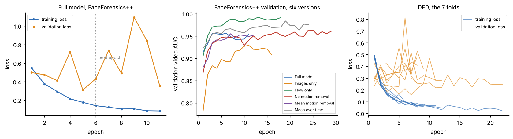

*Left*, the full model on FaceForensics++: the training loss falls steadily, while the validation loss
jumps from epoch to epoch (from 0.31 to 1.10) although the validation AUC stays between 0.94 and 0.96.
The ranking of the videos is stable, but the calibration of the probabilities changes a lot from epoch
to epoch; this is a reason to select the model on AUC and to choose the threshold on validation.
*Middle*, the validation AUC of the six versions. *Right*, the 7 DFD folds: the gap between training
and validation loss appears in the first epochs.

| Version (FaceForensics++) | Best epoch | Epochs run | Mean time per epoch | Total time |
|---|---|---|---|---|
| Full model | 6 | 11 | 274 s | ≈ 50 min |
| Images only | 11 | 16 | 126 s | ≈ 34 min |
| Flow only | 13 | 18 | 160 s | ≈ 48 min |
| No motion removal | 24 | 29 | 239 s | ≈ 1 h 56 |
| Mean motion removal | 7 | 12 | 248 s | ≈ 50 min |
| Mean over time | 19 | 24 | 261 s | ≈ 1 h 44 |

Each epoch includes training and the validation pass. Preprocessing (detection, tracking and RAFT) is
the most expensive step: about 5–8 s per video (§10.0), about 6 h for the 3,000 FaceForensics++ videos.

---

## 11. Problems met while running, and solutions

| # | Problem | Cause | Solution |
|---|---|---|---|
| P1 | Environment setup failed | Python 3.15 is too new for PyTorch | Python 3.10–3.14 required; `check_env` verifies it |
| P2 | Test previews showed the wrong person or a face leaving the crop | fixed crop box; several people in the frame | tracking, main-subject rule, exclusion of ambiguous frames (§3) |
| P3 | Many false alarms at 0.5 on DFD | some real actors score just above 0.5 | threshold chosen on validation videos |
| P4 | FaceForensics++ fakes of different methods overwrote each other | the 4 methods use the same file names | method prefix in the names (`DF-`, `F2F-`, `FS-`, `NT-`); the prefix contains no `_`, so identity grouping is unchanged |
| P5 | 3 of the first 17 FaceForensics++ videos rejected as "face too small" | many FaceForensics++ videos are low resolution | minimum face width 50 px for FaceForensics++; rejections for small faces fell to 1 of the 1,000 real videos |
| P6 | FaceForensics++ download stopped after a few videos | the download script hung on one file | restart; the script skips finished files |
| P7 | The experiment chain stopped after the first training, with all its results saved | most likely Python returned an error code while shutting down on Windows | the experiment runner judges success by the output files (`results.json`), not by exit codes |
| P8 | A Windows batch script closed instantly | a faulty automated edit had corrupted it | rewritten; all batch scripts were later replaced by one cross-platform Python runner (`experiments.py`) |

---

## 12. Project timeline: from the first version to now

This is the order in which the work was done, with what each step showed and what it changed.

| Step | What was done | What it showed | What changed |
|---|---|---|---|
| 1 | Reviewed the first version line by line (§2) | 11 problems, the worst being the leaky split and the wrong RAFT input range | Decided to rebuild the pipeline instead of patching it, keeping the first version untouched for comparison |
| 2 | Wrote the new pipeline: preprocessing, data protocol, network, training/evaluation, prediction, web interface | — | Every problem of §2.2 addressed (§3–§8) |
| 3 | Set up a clean environment (virtual environment, PyTorch with CUDA 12.6) and an environment check | Python 3.15 was too new for PyTorch (P1) | Python 3.14; the check runs RAFT, every network variant and a one-epoch training on random data before any real run |
| 4 | Downloaded DFD (c23) with the official FaceForensics script | — | — |
| 5 | Preprocessed two small test folders and looked at every preview image | With a fixed crop box, faces left the box when people moved; in two-person scenes the wrong person could be cropped (P2) | Face tracking, main-subject rule, frontality, rival-face rule, inside-the-frame rule, reasons logged for every rejection. In the second test, a two-person video was correctly excluded as ambiguous |
| 6 | Preprocessed DFD overnight (about 2 h 50 min, about 8 s per video) | 354/363 real and 956/1,000 fake videos usable; the rejected ones were two-person shots, profiles or too short | — |
| 7 | First training, one split by actor | Video AUC 0.984, but 11 false alarms at the 0.5 threshold, 8 from one actor; only 4 actors in the test set (§10.1) | Threshold chosen on validation videos; 7-fold cross-validation by actor |
| 8 | Literature check of optical-flow and temporal deepfake detectors | Optical flow as input, flow + LSTM and two-stream image + flow detectors are all published. Removing the head's rigid motion from the flow (affine fit) was not found. Published methods train on FaceForensics++ and test on Celeb-DF and DFD | Positioned the work as a study of motion-compensated flow; added FaceForensics++ training and cross-dataset tests |
| 9 | 7-fold cross-validation on DFD (about 3 h) | AUC 0.972 ± 0.017; fold 1 reproduced step 7 exactly; best epochs often 3–4 (§10.2) | — |
| 10 | Downloaded Celeb-DF v2 and preprocessed it (about 3 h) | 510 of the 518 official test videos usable | — |
| 11 | Tested the 7 DFD models on Celeb-DF | AUC 0.781 ± 0.032: a clear drop, but well above chance; the DFD threshold gives 22–54% false alarms on Celeb-DF (§10.3) | Cross-dataset results reported as AUC |
| 12 | Added FaceForensics++ support: official split, method prefixes, validation and test fakes always kept | The four methods share file names (P4) | Method prefix in names; the code checks that every source id stays on one side |
| 13 | Downloaded FaceForensics++ (c23) | The download script hung once (P6) | Restarted; finished files are skipped |
| 14 | Preprocessed FaceForensics++ | First attempt: 3 of the first 17 videos rejected as "face too small" (P5) | Minimum face width 50 px for FaceForensics++, restarted; 2,967 of 3,000 videos usable, about 6 h |
| 15 | Trained the full model on FaceForensics++ and started the ablations | AUC 0.967 on FaceForensics++, 0.820 on DFD, 0.719 on Celeb-DF; the experiment chain stopped once (P7) and a batch script was corrupted (P8) | Success judged by output files; scripts rewritten |
| 16 | Ablations: images only, flow only, the three head-motion settings and the temporal head (§10.5); a computer freeze interrupted one run, which was restarted from scratch and reproduced the lost epochs exactly | Flow alone: among the best on FaceForensics++ but worst on unseen data. Removing only the mean displacement generalises best (0.870 on DFD, 0.739 on Celeb-DF), better than the affine removal | Mean motion removal becomes the candidate to confirm with more seeds |
| 17 | Restructured the code into one package, with tests and documentation | The restructured code gives identical results to the scripts used for the runs | Batch scripts replaced by one Python runner; paths configurable; no hard-coded locations |

---

## 13. How each part was tested

| What | How it was tested | Result |
|---|---|---|
| Environment | environment check: Python version, packages, GPU, RAFT on random images, every network variant, one training epoch on random data, face model (today split between `check_env` and the unit tests) | all checks passed on the laptop before the first real run |
| Face crops | preview image of every processed video (first and last frame of every clip), inspected on the two test folders and spot-checked on each dataset | wrong-person and lost-face cases found and fixed (P2) |
| Exclusions | one CSV line per video with the reason; counts reviewed after each dataset | §10.0; most exclusions are two-person shots or profiles |
| No identity leak | `assert_no_leak` runs on every split of every run and stops the run if a video or an identity is in two parts | never triggered in a real run; a unit test checks that it does trigger on a leaky split |
| Official test sets complete | Celeb-DF test list and FaceForensics++ validation/test fakes forced into the selection; coverage counted from the logs | 510/518 and 695/700 usable |
| FaceForensics++ split | synthetic names for all 1,000 ids × 4 methods: every video assigned, no id on two sides | correct |
| Reproducibility | the first single-split run and fold 1 of the 7-fold run use the same split and seed | identical results to four decimals |
| Restructured code | old scripts and new package trained on the same test dataset with the same seed | identical losses, AUCs and thresholds |
| Unit tests (`tests/`, 16 tests, CPU only) | affine motion removed exactly; residual motion kept; flip mirrors and negates dx; identity keys; every video tested exactly once in 7 folds without leak; leak detection; official FaceForensics++ split; metrics, threshold and video averaging; all 6 network variants; training, testing and the summary table end to end; flow scale | all pass |
| Preprocessing end to end | synthetic video with a real face image moving across the frame, YuNet face model, RAFT code | correct shapes, face found and tracked |
| Prediction end to end | the same video through `predict` with a trained checkpoint | verdict produced from the checkpoint's own settings and threshold |

---

## 14. Code walkthrough

The package is `deepfake_flow`; command-line modules are run as `python -m deepfake_flow.<module>`.

### 14.1 `paths.py`
Finds the three external components without any machine-specific path: the RAFT code, the RAFT
weights and the YuNet model. Each comes from a command-line argument, else an environment variable
(`DEEPFAKE_RAFT_DIR`, `DEEPFAKE_RAFT_WEIGHTS`, `DEEPFAKE_FACE_MODEL`), else a default folder inside the
repository (`third_party/RAFT`, `models/`).

### 14.2 `faces.py`: which face, and where the clips go
- `FaceDetector.faces(frame)`: runs YuNet on the frame (downscaled to 640 px if larger) and returns each
  face as a box in full-resolution pixels, its detection score and its **frontality** (distance between
  the eyes / face width).
- `link_tracks(scan)`: goes through the scan frames in order; each face, largest first, joins the track
  whose last box centre is nearest, if within 0.6 face widths and seen in the last 3 scan frames;
  otherwise it starts a new track.
- `main_track(tracks)`: the track with the largest total area of frontal detections; `None` if no
  frontal face exists (the video is then rejected).
- `valid_scan_positions(...)`: for each scan frame, whether the main subject is usable, and if not, why:
  absent, profile, small, outside the frame, or ambiguous (another frontal face of similar size).
- `choose_windows(...)`: all start frames whose whole window is covered by valid scan frames, then up
  to K starts spread evenly over the video with no overlap between windows.
- `interpolate_boxes` / `smooth_boxes`: the box on every frame of a window, by linear interpolation
  between scan detections, then a 5-frame moving average.

### 14.3 `flow.py`: RAFT and the flow transforms
- `load_raft(...)`: loads RAFT from a clone of the official repository with the Sintel weights (mixed
  precision on GPU).
- `compute_flows(crops, ...)`: converts the L+1 crops to tensors **in 0..255** (the 256 × 256 crops
  already have the size multiple of 8 that RAFT needs), runs RAFT on pairs (t, t+1) in batches of 10 with 32 iterations, resizes each flow map to
  128 × 128 and returns float16 maps of shape (L, 2, 128, 128).
- `compensate_motion(flow, mode)`: `none` returns the flow; `mean` subtracts each map's mean
  displacement; `affine` fits `[x, y, 1] · coefficients` to dx and dy by least squares, using a cached
  pseudo-inverse of the design matrix, and subtracts the fit.
- `flip_flow(flow)`: mirrors the maps horizontally and negates dx.
- `estimate_flow_scale(samples, mode)`: root mean square of the compensated flow over 200 random
  training clips; the single scale of the dataset.

### 14.4 `preprocess.py`: video to files
- `extract_clips(video, detector, config)`: reads the frame count and rate; scans faces every
  `fps / 8` frames; builds tracks, picks the main subject, marks valid scan frames, chooses the windows;
  reads only the needed frames; crops each frame around the smoothed box (×1.3, black padding,
  256 × 256). Raises an error with the reason when no clip is usable (the error goes to the log).
- `process_video(...)`: `extract_clips`, then `compute_flows` on every clip, then the crops resized to
  128 × 128; returns the two arrays and the information written to the log.
- `select_videos(...)`: the videos that must be kept (official test lists) plus a reproducible random
  sample of the others.
- `check_or_write_config(...)`: writes `preprocess_config.json` the first time; afterwards refuses to
  write into the folder with different settings.
- `main()`: the command line. For each selected video, skips it if both files exist; otherwise
  processes it, writes the crops, then the flow (through a temporary file, so a half-written flow file
  never exists), a preview image and one log line. One failing video never stops the run.

### 14.5 `data.py`: what goes into training and testing
- `list_videos(root)`: one record per video that has both files, with its label from the folder name.
- `group_key(name)`: the identity of a video: the text before the first `_` (DFD actor, Celeb-DF
  celebrity), or the target id for FaceForensics++.
- `split_videos(...)`: an official test list if given, otherwise a test part by identity; then a
  validation part by identity (`GroupShuffleSplit`, about 15%).
- `split_videos_kfold(...)`: fold k of a `StratifiedGroupKFold` by identity; validation held out from
  the training identities.
- `split_videos_ffpp(...)`: real video `a` goes to the part of `a`; fake `a_b` to the part of the pair
  `[a, b]`; checks that no source id is on two sides.
- `assert_no_leak(...)`: stops the run if a video or an identity is in two parts.
- `make_clips(...)`: turns the videos of a part into clip samples (file, file, clip index), after the
  split.
- `ClipDataset`: loads one clip (memory-mapped), removes the head motion, divides by the dataset scale,
  flips flow and images with probability 0.5 during training, and returns the 20 flow maps, the 20 face
  images (frame t of each pair) and the label.
- `make_loader(...)`: a PyTorch loader with seeded workers.

### 14.6 `model.py`: the network
- `make_encoder(in_channels)`: torchvision ResNet18 with ImageNet weights; for 2 channels, the first
  convolution is rebuilt with each filter set to the mean of its 3 pretrained colour filters; the final
  classification layer is removed, so the encoder outputs 512 values per image.
- `DeepfakeNet(mode, temporal)`: runs the flow encoder and/or the image encoder on every step of the
  clip (images normalised with ImageNet statistics), joins their features, and either passes the
  sequence through a 2-layer LSTM (hidden 128) and keeps its last hidden state, or averages the steps;
  then dropout 0.3 and a linear layer to 2 classes.

### 14.7 `metrics.py`
- `compute_metrics(y, p, threshold)`: AUC, accuracy, balanced accuracy, precision, recall, F1,
  false-alarm rate and confusion matrix, with fake as the positive class.
- `choose_threshold(y, p)`: the ROC point that maximises true-positive rate − false-positive rate.
- `aggregate_by_video(...)`: the mean of the clip probabilities of each video.
- `bootstrap_auc_ci(...)`: 95% interval of the video AUC from 1,000 resamples of the test videos.

### 14.8 `train.py` and `evaluate.py`
- `train.main()`: lists the videos, makes the split, builds the clips, computes the flow scale and the
  class weights from the training part only, writes the configuration and the split, then calls
  `train_model`.
- `train_model(...)`: AdamW, mixed precision, weighted cross-entropy, gradient accumulation over 4
  batches (including the last incomplete group); after each epoch, the validation video AUC; the best
  epoch is saved with its configuration; stops after 5 epochs without improvement.
- After training: reloads the best epoch, chooses the threshold on the validation videos, stores it in
  the checkpoint, and calls `test_model`.
- `test_model(...)`: predicts the test clips, averages them per video, computes the metrics at 0.5 and
  at the validation threshold with the bootstrap interval, writes `results.json` and
  `test_predictions.csv`.
- `evaluate.main()`: loads a checkpoint and tests it unchanged on all videos of another dataset (or
  those of an official list), with the model's own flow scale and threshold; notes any difference in
  preprocessing settings.

### 14.9 `predict.py` and `app.py`
- `DeepfakeDetector`: loads RAFT, YuNet and the trained network once, with the preprocessing settings,
  flow scale and threshold stored in the checkpoint. `predict(video)` runs the same preprocessing as
  training, scores each clip, averages them and returns the probability, the threshold, the verdict,
  the per-clip probabilities and the number of faces seen.
- `app.py`: a Streamlit page that uploads a video to a temporary file, calls `DeepfakeDetector` and
  shows the verdict.

### 14.10 `summarize.py`, `experiments.py`, `check_env.py`
- `summarize`: reads every `results.json` under a runs folder and writes one table per run and one per
  configuration (mean and standard deviation over folds or seeds).
- `experiments`: each stage of the project in order (preprocessing of each dataset, DFD
  cross-validation, DFD → Celeb-DF, the 6 FaceForensics++ configurations with their cross-dataset
  tests, the summary). Each step is skipped when its output exists, and success is judged by the output
  files.
- `check_env`: checks Python, the packages, the GPU, RAFT on random images and the face model; the code
  itself is checked by the unit tests (§13).

### 14.11 Files written by each command

| Command | Writes |
|---|---|
| `preprocess` | `<out_root>/<Real or Fake>/<video>.flow.npy` (float16, clips × 20 × 2 × 128 × 128) and `<video>.rgb.npy` (uint8, clips × 21 × 128 × 128 × 3); `preprocess_config.json` (the settings, shared by the whole folder); `log_<label>_<folder>.csv` (one line per video: usable or not, why, frames, rate, clips, faces seen, valid share, face size, seconds); `selection_<label>_<folder>.json` (which videos were selected and why); `_previews/<label>/<video>.jpg` |
| `train` | `config.json`, `split.json`, `history.json` (per epoch: training loss and accuracy, validation loss, clip and video AUC, time), `best.pth` (weights, configuration, flow scale, epoch, threshold), `results.json`, `test_predictions.csv` (per test video: label, probability, predictions at 0.5 and at the validation threshold) |
| `evaluate` | `config.json`, `split.json` (the tested videos), `results.json`, `test_predictions.csv` |
| `summarize` | `summary.csv` (one line per run) and `summary_by_config.csv` (mean and standard deviation per configuration) |
| `predict` | nothing; prints the verdict, the probability, the threshold and the probability of each clip |

### 14.12 Command-line arguments

`experiments`, `summarize`, `predict` and `check_env` only take folders and file locations (see
`--help`). The three main commands:

**`python -m deepfake_flow.preprocess`**

| Argument | Default | Meaning |
|---|---|---|
| `--videos_dir` | required | folder with the video files of one class |
| `--label` | required | one of Real, Fake |
| `--out_root` | required | output folder of the dataset |
| `--fps` | 0 | 0 = consecutive frames (default); e.g. 5 = one frame every 0.2 s |
| `--clip_len` | 20 | flow maps per clip |
| `--clips` | 6 | clips per video (at most) |
| `--crop_size` | 256 | face crop size given to RAFT |
| `--save_size` | 128 | size at which flow and crops are stored |
| `--margin` | 1.3 | enlargement of the face box |
| `--iters` | 32 | RAFT refinement iterations |
| `--min_face` | 80 | minimum face width in pixels |
| `--no_face_crop` | off | whole frame squashed (comparison only) |
| `--batch` | 10 | frame pairs per RAFT batch |
| `--max_videos` | 0 | random subset size (0 = all) |
| `--must_include` |  | list file of videos always kept (e.g. the official Celeb-DF test list) |
| `--must_include_ffpp` |  | folder of the official FaceForensics++ split: always keep its validation and test fakes |
| `--seed` | 42 | seed of the random video subset |
| `--name_prefix` |  | text put before every output name, e.g. DF- for FaceForensics++ Deepfakes (the four methods share file names); must not contain '_' |
| `--face_model` |  | YuNet .onnx file (see paths.py) |
| `--raft_dir` |  | clone of the RAFT repository (see paths.py) |
| `--raft_weights` |  | RAFT weights file (see paths.py) |

**`python -m deepfake_flow.train`**

| Argument | Default | Meaning |
|---|---|---|
| `--flow_root` | required | folder written by deepfake_flow.preprocess |
| `--out_dir` | required | where the results of this run are written |
| `--mode` | two_stream | one of two_stream, flow, rgb |
| `--temporal` | lstm | one of lstm, mean |
| `--motion` | affine | head motion removed from the flow; one of affine, mean, none |
| `--test_list` |  | official test list (e.g. Celeb-DF) |
| `--ffpp_splits` |  | folder with the official FaceForensics++ train.json / val.json / test.json |
| `--folds` | 0 | K-fold split by identity (e.g. 7); 0 = one split |
| `--fold` | 0 | which fold is the test set (0 .. folds-1) |
| `--group_by` | prefix | identity = text before the first '_' (default) or each video alone; one of prefix, video |
| `--val_fraction` | 0.15 | share of identities held out for validation |
| `--test_fraction` | 0.15 | share of identities held out for test (own split only) |
| `--seed` | 42 | seed of the split, the sampling and the weights |
| `--batch_size` | 4 | clips per batch |
| `--num_workers` | 2 | data-loading processes (0 = main process) |
| `--accumulation_steps` | 4 | batches per optimiser step (effective batch 16) |
| `--epochs` | 30 | maximum number of epochs |
| `--patience` | 5 | stop after this many epochs without a better validation AUC |
| `--lr` | 0.0001 | AdamW learning rate |
| `--weight_decay` | 0.0001 | AdamW weight decay |
| `--no_flip` | off | disable horizontal-flip augmentation |
| `--no_pretrained` | off | do not load ImageNet weights |

**`python -m deepfake_flow.evaluate`**

| Argument | Default | Meaning |
|---|---|---|
| `--checkpoint` | required | best.pth written by deepfake_flow.train |
| `--flow_root` | required | folder written by deepfake_flow.preprocess |
| `--out_dir` | required | where the results of this run are written |
| `--test_list` |  | test only these videos (e.g. official list) |
| `--seed` | 42 | seed of the split, the sampling and the weights |
| `--batch_size` | 4 | clips per batch |
| `--num_workers` | 2 | data-loading processes (0 = main process) |


### 14.13 Tests and figures
- `tests/test_pipeline.py`: the 16 tests of §13, run with `python -m pytest tests`. They create small
  random datasets in a temporary folder, so they need no dataset, no GPU and no RAFT.
- `docs/make_figures.py`: draws every figure of this document into `docs/figures/` (and the French
  version into `docs/figures/fr/` with `--lang fr`). A French translation of this document is in
  `EXPERIMENTS_fr.md`. The illustrations
  are drawn shapes, not dataset images; the head-motion figure runs the project's own
  `compensate_motion`; the charts use the numbers of section 10, and the training curves the file
  `docs/data/training_histories.json`, copied from the runs' `history.json` files.

---

## 15. Next steps

- Repeat mean against affine motion removal, and LSTM against mean over time, with 2–3 seeds each.
- Train with all 1,000 fakes per FaceForensics++ method.
- Augmentation: blur, video recompression, colour jitter.
- Measure the effect of the first version's leaky split directly: same data, split by window versus
  split by identity.
- Use the flow as an extra input to an existing strong detector, or a backbone pretrained on faces.

---

## 16. How to reproduce

See the README for installation. Then, with the datasets in their official layout:

```
python -m deepfake_flow.check_env
python -m deepfake_flow.experiments preprocess-dfd preprocess-celebdf preprocess-ffpp \
    --flows_dir <flows> --dfd_dir <DFD> --celebdf_dir <Celeb-DF-v2> --ffpp_dir <FaceForensics++>
python -m deepfake_flow.experiments dfd-cv dfd-to-celebdf ffpp summary \
    --flows_dir <flows> --celebdf_dir <Celeb-DF-v2>
```

Every number in section 10 comes from the `results.json` files these commands write. The code was
restructured after the runs above (one package instead of separate scripts, no change to any
computation); on the same data and seed, the restructured code gives identical results to the
original scripts (checked on a test dataset: identical losses, AUCs and thresholds).

The datasets are not included; they must be requested from their authors.

---

## 17. Related work and positioning

**Datasets and frame-based detectors.** FaceForensics++ [1] set the most used protocol (four
manipulation methods, c23 and c40 compression) and showed that an image network (XceptionNet) detects
the fakes it saw in training very well. Celeb-DF [2] was built with an improved swapping method and
shows that such detectors lose a lot on fakes of another kind. DFD [3] was released by Google and Jigsaw
with consenting actors. Generalisation to unseen datasets has since been the central question of the
field.

**Temporal methods.** Early detectors combine an image network and a recurrent network: Güera and
Delp [4] use a CNN followed by an LSTM, Sabir et al. [5] recurrent strategies on aligned faces. More
recent methods try to force the network to use temporal information rather than appearance: FTCN [6]
reduces the spatial size of the convolutions to 1 to keep only temporal coherence, LipForensics [7] and
RealForensics [8] learn mouth motion from lip-reading videos or real talking people, and AltFreezing
[9] alternates training of the spatial and temporal weights. They are currently among the best methods
for generalisation to Celeb-DF (§10.4).

**Optical flow and motion.** Amerini et al. [10] were among the first to classify optical-flow maps
directly with a CNN; Saikia et al. [11] combine optical flow, a CNN and an LSTM; Das et al. [12] use two
transformers, one on the images and one on the flow. PhaseForensics [13] replaces optical flow with a
motion representation based on the phase of frequency bands of face sub-regions, and has the best
generalisation to Celeb-DF in this list. GC-ConsFlow [14] is the work closest to this one: it uses
*optical-flow residuals* precisely to reduce the natural motion of the face, with a second stream on
appearance.

**Positioning of this project.** This project uses a simple two-stream design, image and flow [15],
with ResNet18 [16] and an LSTM [17], and focuses on one precise question: *how much* of the head's
motion should be removed from the flow before analysing it? An explicit, parametric removal of the
rigid motion (translation or least-squares affine fit), compared in a controlled ablation with no
removal, was not found in the literature reviewed (§12, step 8). GC-ConsFlow pursues a similar aim by
other means, however, and the literature was not reviewed exhaustively: this novelty must be checked
more widely before any publication. The main contribution is therefore less a new detector than a
carefully controlled measurement (identity-based splits, official test sets, confidence intervals,
ablations that change one thing), with an unexpected result: removing only the translation generalises
better than the affine fit.

---

## 18. Limitations and threats to validity

- **One seed per version on FaceForensics++.** The intervals of §10.5 measure the variation due to the
  test videos, not that due to training (initialisation, batch order). The gap between mean and affine
  motion removal on DFD (0.870 against 0.820, non-overlapping intervals) is the strongest result, but it
  must be confirmed with 2–3 seeds; gaps of a few hundredths on Celeb-DF allow no conclusion.
- **Subsampling.** 500 of the 1,000 fakes per FaceForensics++ method, 1,000 of the 3,068 DFD fakes and
  1,500 of the 5,639 Celeb-DF fakes were preprocessed (the official test sets are complete). More
  training data could change the scores and perhaps the ranking of the versions.
- **Excluded videos.** Results are on the usable videos (510 of 518 for Celeb-DF, 695 of 700 for
  FaceForensics++). A detector used in practice would also have to handle two-person shots and
  profiles, which the current pipeline sets aside.
- **Indicative comparison with the literature** (§10.4): different protocols, no method retrained under
  the same conditions.
- **Robustness not tested.** Only c23 compression was used; heavy compression (c40), blur, resizing and
  adversarial perturbations were not evaluated.
- **Hyperparameters chosen by reasoning** (§3.4, §7), without a systematic search; other values (clip
  length, frame rate, input size) might give better results.
- **Unverified explanation.** The idea that the affine fit removes part of the useful signal (jaw and
  cheek movements) is a hypothesis; it could be tested, for example by measuring the residual energy per
  face region for each setting.
- **Threshold not transferable** between datasets (§10.3): real use would need calibration on data from
  the target domain.
- **Computing cost.** RAFT makes preprocessing slow (5–8 s per video on the machine used), which limits
  real-time use.
- **Dated datasets** (2019–2020). Recent forgeries (diffusion models, face reenactment from a single
  image) were not tested.
- **Post-hoc analyses.** The per-method (§10.6) and per-real-video-type (§10.7) results were computed
  after the experiments, from the saved predictions; they help to understand the results, not to choose
  a model.

---

## 19. References

Datasets and compared methods

1. A. Rössler, D. Cozzolino, L. Verdoliva, C. Riess, J. Thies, M. Nießner. *FaceForensics++: Learning to
   Detect Manipulated Facial Images.* ICCV 2019.
2. Y. Li, X. Yang, P. Sun, H. Qi, S. Lyu. *Celeb-DF: A Large-scale Challenging Dataset for DeepFake
   Forensics.* CVPR 2020.
3. N. Dufour, A. Gully. *Contributing Data to Deepfake Detection Research.* Google AI Blog, September 2019
   (DeepFakeDetection dataset, distributed with FaceForensics++).
4. D. Güera, E. J. Delp. *Deepfake Video Detection Using Recurrent Neural Networks.* AVSS 2018.
5. E. Sabir, J. Cheng, A. Jaiswal, W. AbdAlmageed, I. Masi, P. Natarajan. *Recurrent Convolutional
   Strategies for Face Manipulation Detection in Videos.* CVPR Workshops 2019.
6. Y. Zheng, J. Bao, D. Chen, M. Zeng, F. Wen. *Exploring Temporal Coherence for More General Video Face
   Forgery Detection* (FTCN). ICCV 2021.
7. A. Haliassos, K. Vougioukas, S. Petridis, M. Pantic. *Lips Don't Lie: A Generalisable and Robust
   Approach to Face Forgery Detection* (LipForensics). CVPR 2021.
8. A. Haliassos, R. Mira, S. Petridis, M. Pantic. *Leveraging Real Talking Faces via Self-Supervision for
   Robust Forgery Detection* (RealForensics). CVPR 2022.
9. Z. Wang, J. Bao, W. Zhou, W. Wang, H. Li. *AltFreezing for More General Video Face Forgery Detection.*
   CVPR 2023.
10. I. Amerini, L. Galteri, R. Caldelli, A. Del Bimbo. *Deepfake Video Detection through Optical Flow
    based CNN.* ICCV Workshops 2019.
11. P. Saikia, D. Dholaria, P. Yadav, V. Patel, M. Roy. *A Hybrid CNN-LSTM Model for Video Deepfake
    Detection by Leveraging Optical Flow Features.* arXiv:2208.00788, 2022.
12. S. Das, M. Kolahdouzi, L. Özparlak, W. Hickie, A. Etemad. *Unmasking Deepfakes: Masked Autoencoding
    Spatiotemporal Transformers for Enhanced Video Forgery Detection.* arXiv:2306.06881, 2023.
13. E. Prashnani, M. Goebel, B. S. Manjunath. *Generalizable Deepfake Detection with Phase-Based Motion
    Analysis* (PhaseForensics). IEEE Transactions on Image Processing, vol. 34, pp. 100–112, 2025
    (arXiv:2211.09363, 2022).
14. J. Chen, M. Hu, D. Zhang, J. Meng. *GC-ConsFlow: Leveraging Optical Flow Residuals and Global Context
    for Robust Deepfake Detection.* arXiv:2501.13435, 2025.

Components used

15. K. Simonyan, A. Zisserman. *Two-Stream Convolutional Networks for Action Recognition in Videos.*
    NeurIPS 2014.
16. K. He, X. Zhang, S. Ren, J. Sun. *Deep Residual Learning for Image Recognition* (ResNet). CVPR 2016.
17. S. Hochreiter, J. Schmidhuber. *Long Short-Term Memory.* Neural Computation, 9(8), 1997.
18. Z. Teed, J. Deng. *RAFT: Recurrent All-Pairs Field Transforms for Optical Flow.* ECCV 2020.
19. D. J. Butler, J. Wulff, G. B. Stanley, M. J. Black. *A Naturalistic Open Source Movie for Optical Flow
    Evaluation* (Sintel). ECCV 2012.
20. W. Wu, H. Peng, S. Yu. *YuNet: A Tiny Millisecond-level Face Detector.* Machine Intelligence Research,
    2023.
21. J. Deng, W. Dong, R. Socher, L.-J. Li, K. Li, L. Fei-Fei. *ImageNet: A Large-Scale Hierarchical Image
    Database.* CVPR 2009.
22. I. Loshchilov, F. Hutter. *Decoupled Weight Decay Regularization* (AdamW). ICLR 2019.
23. W. J. Youden. *Index for Rating Diagnostic Tests.* Cancer, 3(1), 1950.
24. B. Efron, R. J. Tibshirani. *An Introduction to the Bootstrap.* Chapman & Hall, 1993.
25. F. Pedregosa et al. *Scikit-learn: Machine Learning in Python.* JMLR, 12, 2011.
