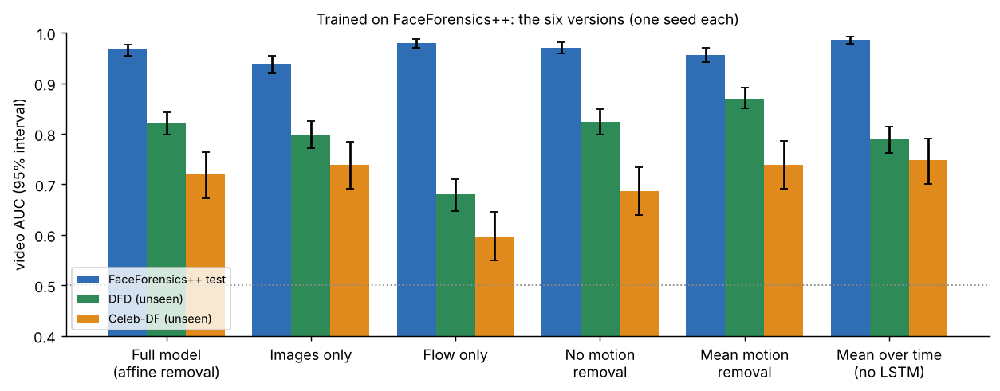
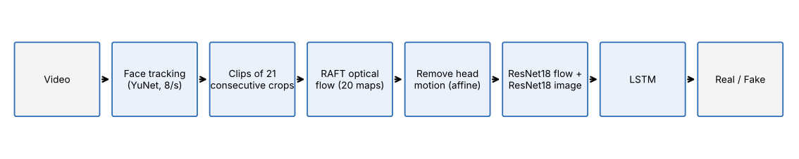
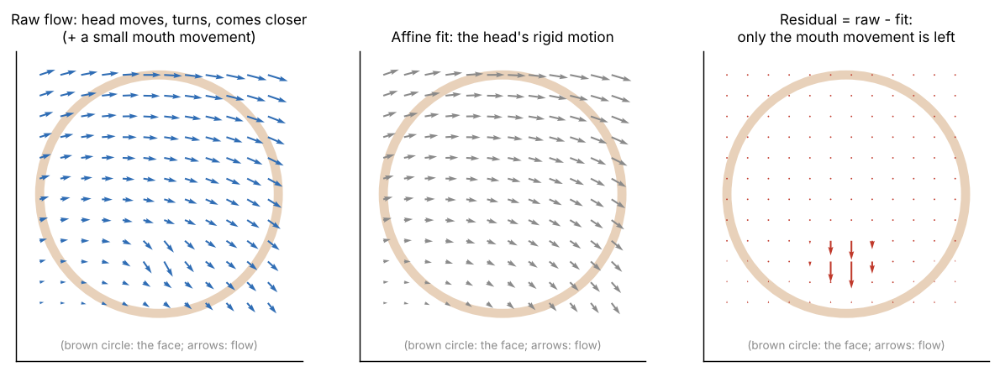

# Deepfake video detection with motion-compensated optical flow

A research project on one question: **does the motion of a face reveal deepfakes, and how much of the
head's own motion should be removed before looking for it?** A face swap is like a mask pasted on a
real head. When the head moves, the mask can slip or flicker very slightly. Those slips are tiny,
however, compared with the large motion of the head itself. This project measures that motion with
optical flow (RAFT), removes the rigid motion of the head in three different ways, and tests which
version generalises best to datasets never seen in training.

**Full documentation:** every design decision, experiment, result, problem and limitation is in
**[EXPERIMENTS.md](EXPERIMENTS.md)** (French: [EXPERIMENTS_fr.md](EXPERIMENTS_fr.md)). The same document is
available as PDF and Word:
[English PDF](docs/Design%20and%20experiment%20log.pdf) ·
[French PDF](docs/Journal%20de%20conception%20et%20d%27exp%C3%A9riences.pdf) ·
[English Word](docs/Design%20and%20experiment%20log.docx) ·
[French Word](docs/Journal%20de%20conception%20et%20d%27exp%C3%A9riences.docx).

## Main findings

1. **Removing only the head's translation generalises best.** Trained on FaceForensics++ and tested
   on unseen datasets, subtracting the mean displacement of each flow map gives a video AUC of
   **0.870 on DFD** and **0.739 on Celeb-DF**. A full affine fit gives 0.820 and 0.719, and no removal
   0.824 and 0.687. On DFD, the 95% intervals of the mean and affine versions do not overlap. This is
   the opposite of what was expected, and the main result of the ablations.
2. **Optical flow alone learns the training dataset, not deepfakes in general.** It scores 0.980 on
   FaceForensics++, including 1.000 on FaceSwap fakes, but only 0.681 on DFD and 0.596 on Celeb-DF.
3. **Scores on the training dataset do not predict generalisation.** The versions that fit
   FaceForensics++ best are not the best on unseen data.
4. **Within one dataset the task is easy; across datasets it is not.** Trained on DFD, the model reaches
   0.972 ± 0.017 on unseen actors (7-fold cross-validation), but 0.781 ± 0.032 on Celeb-DF.
5. **Honest position:** on Celeb-DF these results remain below the best published detectors (0.80–0.91),
   and each FaceForensics++ version was trained with one seed only. See
   [limitations](EXPERIMENTS.md#18-limitations-and-threats-to-validity).



## Method



1. **Face tracking.** YuNet detects faces about 8 times per second. Detections are linked into one
   track per person, and the main subject is the person who faces the camera the most. Frames with a
   second frontal face of similar size are excluded, because the label cannot say which face is fake
   ([§3](EXPERIMENTS.md#3-preprocessing-decisions-and-reasons)).
2. **Clips.** Up to 6 non-overlapping clips of 21 *consecutive* frames per video, cropped around the
   tracked face (256 × 256, margin × 1.3, smoothed box).
3. **Optical flow.** RAFT (Sintel weights, 32 iterations) gives 20 flow maps per clip, stored at
   128 × 128 ([§4](EXPERIMENTS.md#4-raft-optical-flow-what-changed-and-why)).
4. **Head-motion removal.** Each flow map has the head's rigid motion subtracted: nothing (`none`),
   the mean translation (`mean`), or a least-squares affine fit `dx ≈ a·x + b·y + c`, `dy ≈ d·x + e·y + f`
   (`affine`). Flow maps are then divided by one scale for the whole dataset
   ([§5](EXPERIMENTS.md#5-removing-the-heads-motion-from-the-flow)).
5. **Network.** At each of the 20 steps, one ResNet18 reads the flow map and another reads the face
   image. Their features are joined, a 2-layer LSTM reads the 20 steps, and the clip is classified as
   real or fake. A video's score is the mean of its clips' scores
   ([§6](EXPERIMENTS.md#6-the-network-resnet18-and-lstm-changes-and-why)).



## Evaluation protocol

- **No identity on both sides of a split**, checked in code on every run. DFD is split by actor
  (7-fold `StratifiedGroupKFold`), FaceForensics++ uses its official 720/140/140 split, and Celeb-DF
  its official 518-video test list.
- **Videos are split, never clips.** Model selection (video AUC) and the decision threshold (Youden's
  J) use validation videos only.
- **Cross-dataset tests use the trained model unchanged.** Results are reported as video-level AUC
  with 95% bootstrap intervals ([§8](EXPERIMENTS.md#8-evaluation-protocol)).
- **Ablations change one thing at a time:** images only, flow only, the three head-motion settings,
  and mean over time instead of the LSTM.

## Results

Video-level AUC. "Unseen" means a dataset never used in training.

| Trained on | Tested on | AUC | 95% interval |
|---|---|---|---|
| DFD (7-fold by actor) | DFD, unseen actors | 0.972 ± 0.017 | over 7 folds |
| DFD | Celeb-DF (unseen) | 0.781 ± 0.032 | over 7 models |
| FaceForensics++ (official split) | FaceForensics++ test | 0.967 | 0.955–0.977 |
| FaceForensics++ | DFD (unseen) | 0.820 | 0.799–0.842 |
| FaceForensics++ | Celeb-DF (unseen) | 0.719 | 0.672–0.764 |
| FaceForensics++, mean motion removal | DFD / Celeb-DF (unseen) | **0.870 / 0.739** | 0.850–0.891 / 0.691–0.786 |

All six versions on FaceForensics++ (video AUC):

| Version | FF++ test | DFD (unseen) | Celeb-DF (unseen) |
|---|---|---|---|
| Full model (affine removal, LSTM) | 0.967 | 0.820 | 0.719 |
| Images only | 0.939 | 0.798 | 0.738 |
| Flow only | 0.980 | 0.681 | 0.596 |
| No head-motion removal | 0.971 | 0.824 | 0.687 |
| **Mean motion removal** | 0.957 | **0.870** | 0.739 |
| Mean over time (no LSTM) | 0.986 | 0.790 | 0.748 |

Further results in the documentation:
- [per manipulation method](EXPERIMENTS.md#106-results-per-manipulation-method-faceforensics-test): NeuralTextures is
  the hardest method for every version;
- [the two kinds of Celeb-DF real videos](EXPERIMENTS.md#107-celeb-df-the-two-kinds-of-real-videos);
- [training curves](EXPERIMENTS.md#108-training-curves-and-computing-cost);
- [comparison with published methods](EXPERIMENTS.md#104-trained-on-faceforensics-full-model);
- [related work](EXPERIMENTS.md#17-related-work-and-positioning).

## What changed compared with the first version

An earlier prototype of this detector used overlapping windows split at random, so the same frames,
and the same people, were in training and test. It also fed RAFT images in the wrong value range,
used whole frames instead of the face, and skipped frames. The 11 problems found, and how each was
fixed, are listed in [§2](EXPERIMENTS.md#2-the-first-version-and-what-was-wrong-with-it).

## Repository layout

```
deepfake_flow/          the package
  paths.py              where RAFT and the face model are found (arguments, environment, defaults)
  faces.py              face detection (YuNet), tracking, main subject, clip placement
  flow.py               RAFT optical flow; head-motion removal, flip, flow scale
  preprocess.py         video -> face clips -> flow, saved as .npy           [command]
  data.py               preprocessed videos, identity-safe splits, PyTorch dataset
  metrics.py            clip/video metrics, threshold choice, bootstrap interval
  model.py              two-stream ResNet18 + LSTM
  train.py              training, then test on held-out videos              [command]
  evaluate.py           test a trained model on another dataset             [command]
  predict.py            verdict for one video file                          [command]
  summarize.py          one table of all results                            [command]
  experiments.py        every experiment of the project, in order           [command]
  check_env.py          checks Python, packages, GPU, RAFT, face model      [command]
app.py                  web interface (Streamlit)
splits/ffpp/            official FaceForensics++ train/val/test split
tests/                  tests on small random data (CPU only)
models/                 put the face-detection model here (see models/README.md)
third_party/            put the RAFT code here (see third_party/README.md)
EXPERIMENTS.md          design decisions, experiments and results
EXPERIMENTS_fr.md       the same document in French
```

Commands are run from the repository root as `python -m deepfake_flow.<command> --help`.

## Installation

Python 3.10–3.14 and an NVIDIA GPU are needed. The results above were produced on a laptop with an
Intel Core 5 210H processor, 16 GB of DDR5 memory and an NVIDIA GeForce RTX 4050 Laptop GPU (6 GB).

```
python -m venv .venv
.venv\Scripts\activate            (Windows)   or   source .venv/bin/activate   (Linux/macOS)
pip install torch torchvision --index-url https://download.pytorch.org/whl/cu126
pip install -r requirements.txt
git clone https://github.com/princeton-vl/RAFT third_party/RAFT
```

Then download the RAFT weights (`third_party/README.md`) and the YuNet face model (`models/README.md`),
and check the setup:

```
python -m deepfake_flow.check_env
python -m pytest tests
```

## Data

The datasets must be requested from their authors and are not included:

| Dataset | Where to request it | Used for |
|---|---|---|
| FaceForensics++ (c23) and DFD | https://github.com/ondyari/FaceForensics | training (FaceForensics++), training and unseen test (DFD) |
| Celeb-DF v2 | https://github.com/yuezunli/celeb-deepfakeforensics | unseen test (official 518-video test list) |

Keep each dataset in its official folder layout.

## Usage

**Preprocess a folder of videos** (one class at a time):

```
python -m deepfake_flow.preprocess --videos_dir <Celeb-DF-v2>/Celeb-real --label Real --out_root <flows>/CelebDF
```

**Train and test** (here: 7-fold by actor on DFD, fold 0; or the official FaceForensics++ split):

```
python -m deepfake_flow.train --flow_root <flows>/DFD --folds 7 --fold 0 --out_dir runs/dfd_f0
python -m deepfake_flow.train --flow_root <flows>/FFPP --ffpp_splits splits/ffpp --out_dir runs/ffpp
```

Options for the ablations: `--mode two_stream|flow|rgb`, `--motion affine|mean|none`,
`--temporal lstm|mean`.

**Test on another dataset:**

```
python -m deepfake_flow.evaluate --checkpoint runs/ffpp/best.pth --flow_root <flows>/CelebDF \
    --test_list <Celeb-DF-v2>/List_of_testing_videos.txt --out_dir runs/ffpp_to_celebdf
```

**Analyse one video**, on the command line or in the browser:

```
python -m deepfake_flow.predict --video my_video.mp4 --checkpoint runs/ffpp/best.pth
streamlit run app.py -- --checkpoint runs/ffpp/best.pth
```

**Reproduce every experiment** of EXPERIMENTS.md (each stage skips what is already done):

```
python -m deepfake_flow.experiments preprocess-dfd preprocess-celebdf preprocess-ffpp \
    --flows_dir <flows> --dfd_dir <DFD> --celebdf_dir <Celeb-DF-v2> --ffpp_dir <FaceForensics++>
python -m deepfake_flow.experiments dfd-cv dfd-to-celebdf ffpp summary \
    --flows_dir <flows> --celebdf_dir <Celeb-DF-v2>
```

## Third-party components

- RAFT optical flow: Z. Teed and J. Deng, "RAFT: Recurrent All-Pairs Field Transforms for Optical
  Flow", ECCV 2020. Code: https://github.com/princeton-vl/RAFT (BSD-3-Clause).
- YuNet face detector, from the OpenCV Zoo: https://github.com/opencv/opencv_zoo.
- ResNet18 with ImageNet weights, from torchvision.
- FaceForensics++ split files: https://github.com/ondyari/FaceForensics.

## License

The code of this repository is released under the MIT License (see [LICENSE](LICENSE)). The datasets,
the RAFT code and weights and the YuNet model are not included and keep their own licenses and terms
of use; the datasets must be requested from their authors.
